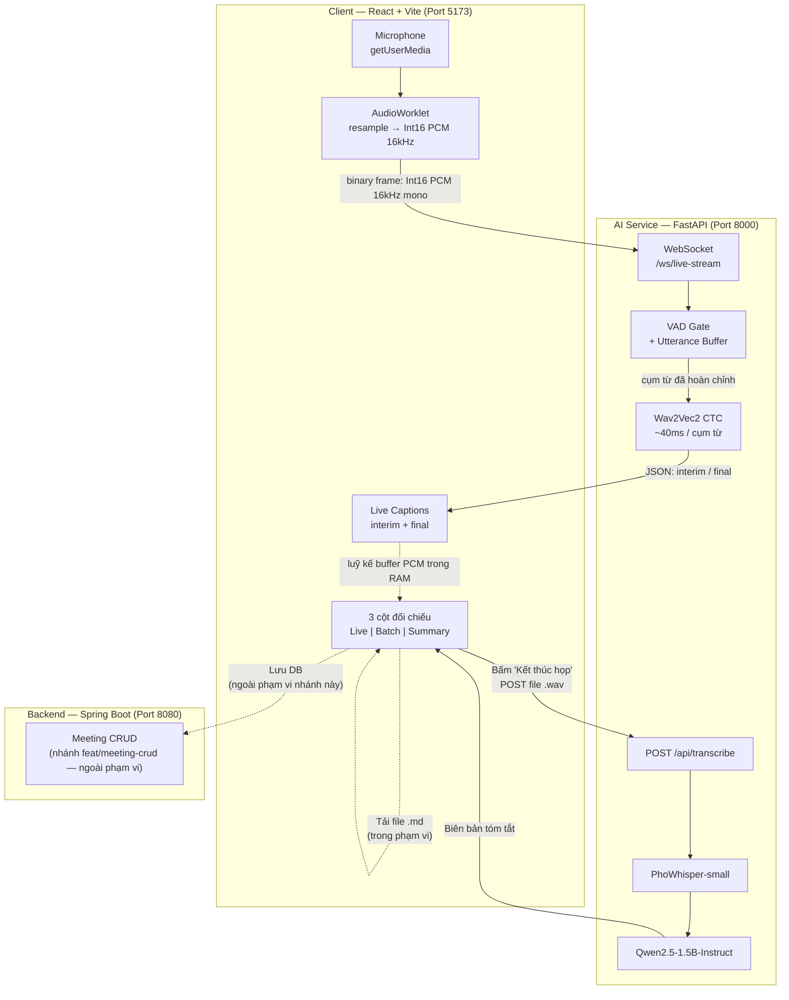

# 📌 KẾ HOẠCH TRIỂN KHAI HỆ THỐNG HYBRID ASR & LLM
## (Dự án: AI Meeting Note — Môn học: Hệ thống thông minh — PTIT)

> **Nhánh làm việc:** `feat/realtime-stt`
> **Phiên bản:** 2.2 — hiệu chỉnh theo **đo lường thật**, không phải ước lượng. Phase 0 đã chạy xong; mọi blocker đã được gỡ.
> **Trạng thái hiện tại:** `/api/transcribe` + `/api/summarize` chạy được. Phase 0 xong. **Chưa code phần realtime.**

### ⚡ Đã có sẵn trong repo (Phase 0 hoàn thành)

| File | Trạng thái | Ghi chú |
| :--- | :--- | :--- |
| [ai-service/vad_buffer.py](ai-service/vad_buffer.py) | ✅ Đã viết + test | `VadGate` + `UtteranceBuffer` + `peek()` — dùng chung cho Phase 0 và Phase 1 |
| [ai-service/test_vad_buffer.py](ai-service/test_vad_buffer.py) | ✅ **31/31 PASS** | Chạy `python test_vad_buffer.py` (không cần pytest) |
| [models_testing/benchmark_chunking.py](models_testing/benchmark_chunking.py) | ✅ Đã viết + chạy thật | Script Phase 0 (WER, độ trễ, VRAM, nghe cảm nhận) |
| [models_testing/results/qualitative_test_2.md](models_testing/results/qualitative_test_2.md) | ✅ Bằng chứng | Kết quả chạy thật — xem mục 5.3 |

**Ba kết luận của Phase 0:**

1. ✅ **Giả định cốt lõi ĐÚNG.** Cắt theo VAD cho text gần như hoàn hảo (0 token `<unk>`); cắt cứng 500ms cho text vỡ vụn (mục 5.3).
2. ⚠️ **Độ trễ thật LỚN HƠN DỰ KIẾN.** Người nói đọc liên tục ⇒ hầu như không có khoảng lặng ⇒ **trần cụm là thứ cắt, không phải VAD**. Ở trần cũ 15s, độ trễ thật là **6.75s**; hạ trần xuống 8s → **4.03s** (Bảng 4a).
3. ⟹ **`interim` caption từ "tuỳ chọn" trở thành BẮT BUỘC** (mục 3.5). Đây là hệ quả thiết kế quan trọng nhất của Phase 0.
4. 🚨 **`webrtcvad` không tất định** — số liệu phụ thuộc cách gọi. Bản plan trước đã báo cáo sai (ghi 6 cụm / trễ 3.03s, trong khi cách đo đúng ở trần cụm 15s cho **3 cụm / trễ 6.75s** — sai gấp đôi). Đã có quy tắc đo bắt buộc (phát hiện 3, mục 5.4).

**Blocker đã gỡ:** `websockets` đã cài + test thật với uvicorn · `requirements.txt` đã sang UTF-8 · `peek()` đã thêm cho interim (mục 6.1).

---

## 0. NHỮNG THAY ĐỔI SO VỚI BẢN PLAN 1.0

Đọc mục này trước, nếu không sẽ tưởng các con số dưới đây là bịa.

| # | Nội dung | Bản 1.0 | Bản 2.0 (bản này) |
| :-: | :--- | :--- | :--- |
| 1 | Model ID Wav2Vec2 | `nguyenvanhieuvn/...` ❌ **không tồn tại** | `nguyenvulebinh/wav2vec2-base-vietnamese-250h` ✅ |
| 2 | Target độ trễ bản `final` | "< 200ms" ❌ bất khả thi | **p50 ≤ 4.5s / p95 ≤ 5.0s** — đo thật **4.03s** (Bảng 4a, mục 5.3). Trần dưới là **giới hạn vật lý** do độ dài cụm từ. |
| 3 | Target độ trễ bản `interim` | *(không có)* | **p50 ≤ 1.0s** — mục tiêu mới, khả thi vì không phải chờ hết cụm |
| 4 | **`interim` caption** | "Tuỳ chọn — làm sau nếu còn thời gian" | ⚠️ **BẮT BUỘC** — nâng cấp sau khi đo được cụm từ dài 3–8s (mục 3.5, 5.3) |
| 5 | Cách cắt chunk | Cắt cứng mỗi 500–800ms | **Cắt theo VAD** (kết thúc ở khoảng lặng) |
| 6 | Độ dài cụm tối đa | 15s | **8s** — hạ xuống để chặn trần độ trễ ở 4.0s (mục 4). ⚠️ **Đây là tham số quyết định độ trễ, không phải tham số an toàn** — ở 15s độ trễ thật là 6.75s |
| 6b | **Cách đo số cụm** | Không quy định | 🚨 **Bắt buộc dùng MỘT `VadGate` xuyên suốt** — `webrtcvad` có mô hình thích nghi nên không tất định (phát hiện 3, mục 5.4) |
| 7 | Ảo giác CTC | "Không bị ảo giác khi âm thanh ngắn" ❌ | **Có**, cần VAD để chặn — xem mục 3.3 |
| 8 | Mic tắt tiếng | Không đề cập | **Có lỗ hổng**: webrtcvad coi im lặng số là tiếng nói → đã thêm chốt chặn `DEAD_FRAME_RMS` (mục 5.4) |
| 9 | Dependency | Thiếu `websockets`, `jiwer` | ✅ Đã cài + **test uvicorn chạy thật**; `requirements.txt` đã sang UTF-8 (mục 6.1) |
| 10 | Giao diện thu âm | "ScriptProcessorNode **hoặc** AudioWorklet" | **AudioWorklet** (đã chốt) |
| 11 | Định dạng PCM | "Float32 **hoặc** Int16" | **Int16 PCM** (đã chốt) |
| 12 | Tần số lấy mẫu | Giả định thẳng 16kHz | **Có bước kiểm tra + fallback resample** |
| 13 | VRAM | "4.6GB/6.0GB — hoàn toàn vừa vặn" | **4.72GB — đủ nhưng sát trần** (đo thật, mục 5.3) |
| 14 | De-risk | Không có | **Thêm Phase 0** ✅ đã hoàn thành |
| 15 | Kiểm thử | Không có | `test_vad_buffer.py` **31/31 PASS** (mục 5.4) |
| 16 | Lưu trữ kết quả | Không đề cập | Nêu rõ phạm vi + hướng tích hợp |
| 17 | Điểm chặn | Không có tiêu chí | Mỗi phase có **Definition of Done** |

**Ba việc phải sửa trong code hiện tại trước khi bắt đầu** — xem Phụ lục B.

---

## 1. TỔNG QUAN & MỤC TIÊU

Hệ thống ghi chép và tóm tắt cuộc họp **AI Meeting Note** dùng kiến trúc **Dual-Engine (lai ghép hai mô hình ASR)**:

- **Engine 1 — Realtime Live Stream:** Hiển thị phụ đề tức thời trong lúc họp. Ưu tiên **độ trễ thấp**, chấp nhận độ chính xác thấp hơn.
- **Engine 2 — Batch High-Fidelity:** Tạo bản ghi chép chính thức sau khi họp xong. Ưu tiên **độ chính xác**, chấp nhận chờ vài giây.
- **Engine 3 — Intelligence Summarizer:** Phân tích, trích xuất quyết định và phân công công việc từ bản ghi chép chính thức.

### 1.1. Giá trị học thuật (dùng cho báo cáo)

Đồ án chứng minh nhóm phân biệt được ranh giới giữa hai bài toán có **hàm mục tiêu khác nhau**, chứ không chỉ "chạy được 2 model":

| | Bài toán Streaming | Bài toán Offline Batch |
| :--- | :--- | :--- |
| Ràng buộc chính | **Độ trễ** (latency-bound) | **Độ chính xác** (accuracy-bound) |
| Kiến trúc phù hợp | CTC (không autoregressive, 1 forward pass) | Seq2Seq (autoregressive, có ngữ cảnh toàn cục) |
| Cách đánh giá | latency p50/p95, RTF | WER |
| Xử lý ngữ cảnh | Cục bộ, theo cửa sổ | Toàn cục |

### 1.2. Mục tiêu đo lường được (Definition of Success)

Đây là các con số nhóm **cam kết và sẽ đo**, không phải con số marketing:

| Chỉ số | Mục tiêu | Cách đo | Trạng thái |
| :--- | :--- | :--- | :--- |
| **Độ trễ bản `final` (p50)** | ≤ 4.5s *(đã sửa từ 3.5s)* | Phase 4.1 | ⚠️ Đo thật **4.03s** — xem Bảng 4a |
| **Độ trễ bản `final` (p95)** | ≤ 5.0s | Phase 4.1 | ⚠️ Trần cứng 4.0s, cần đo lại sau khi chốt |
| **Độ trễ bản `interim` (p50)** | **≤ 1.0s** | Phase 4.1 | ⬜ Chưa làm — cần Phase 2 |
| WER engine live (trên tập test chuẩn) | ≤ 20% | Phase 4.1 | ⬜ Chờ TV3 |
| WER engine batch (trên tập test chuẩn) | ≤ 5% | Phase 4.1 | ⬜ Chờ TV3 |
| Thời gian tóm tắt 1 cuộc họp 30 phút | ≤ 60s | Phase 4.1 | ⬜ Chưa đo |
| VRAM đỉnh khi chạy 3 model | < 5.5GB / 6.0GB | ✅ Đo được **4.72GB** | ✅ ĐẠT |

> ⚠️ **Hai loại độ trễ — đừng lẫn.** Bản `final` là text chính thức của một cụm từ, phải chờ
> người nói nghỉ (hoặc chạm trần cụm) mới có → bị chặn dưới bởi **độ dài cụm từ**.
> Bản `interim` là text tạm của phần đang nói dở → phụ thuộc vào **chu kỳ decode**, có thể đạt ~0.5–1s.
> **Để phụ đề có cảm giác "realtime", bắt buộc phải có `interim`.** Xem mục 3.5.
>
> ✅ **Đã đo được ở Phase 0** (audio 36.5s, `data_test/test_2.mp3`): text bản `final` gần như hoàn hảo,
> RTF ≤ 0.005, đỉnh VRAM 4.72GB. Chi tiết ở mục 5.3.

> ⚠️ **Không được viết "< 200ms" vào slide.** Bản 1.0 cam kết con số đó và **không thể đạt được** — bản thân một cụm từ tiếng Việt đã dài 3–8 giây, mà text `final` chỉ có sau khi cụm kết thúc.
>
> 🚨 **Cũng không được viết "3.0s".** Con số đó đã bị phát hiện là **sai** (xem phát hiện 3, mục 5.4 — `webrtcvad` không tất định). Số đúng sau khi hạ trần cụm xuống 8s là **p50 = 4.03s**.
>
> 💡 Cách trình bày nên dùng: *"Chúng em không hứa 200ms. Chúng em đo được **4.0s** cho bản chính thức, và bằng kiến trúc `interim` hai tầng, độ trễ **cảm nhận** giảm xuống dưới 1 giây."* Trung thực + có số đo mạnh hơn nhiều so với một con số đẹp mà không ai kiểm chứng được.

---

## 2. KIẾN TRÚC HỆ THỐNG



### 2.1. Quyết định kiến trúc đã chốt

| Quyết định | Lựa chọn | Lý do |
| :--- | :--- | :--- |
| **Frontend gọi thẳng AI Service hay qua Spring Boot?** | **Gọi thẳng** (`localhost:8000`) | (1) Spring Boot hiện chưa có controller nào, (2) `spring-boot-starter-websocket` chưa có trong `pom.xml` — proxying WS qua Spring sẽ tốn công vô ích, (3) không có nhu cầu auth/business logic cho luồng realtime. **Đây là quyết định có chủ đích, phải ghi vào báo cáo** để giải thích vì sao kiến trúc 3 tầng không áp dụng cho luồng này. |
| **Lưu kết quả cuộc họp** | **Ngoài phạm vi nhánh `feat/realtime-stt`** | Việc lưu DB thuộc các nhánh `feat/entity`, `feat/repository`, `feat/meeting-crud`. Nhánh này chỉ đảm bảo **xuất file `.md`/`.txt`** để không mất dữ liệu khi F5. Tích hợp DB làm ở PR sau. |
| **Audio transport** | **Binary frame thô (Int16 PCM)** | Không base64/JSON-wrap audio: giảm 33% băng thông và bỏ chi phí encode/decode mỗi chunk. |
| **Cắt chunk** | **Theo VAD** (không cắt cứng theo thời gian) | Xem mục 3.3 — đây là quyết định quan trọng nhất của bản plan này. |

---

## 3. SO SÁNH MÔ HÌNH & CƠ SỞ KHOA HỌC

### 3.1. Bảng so sánh

> ✅ = **số đo thực tế** từ [models_testing/](models_testing/) (20 mẫu VIVOS test, full utterance, avg 4.79s, RTX 4050) — dùng được trong báo cáo.
> 🔶 = **ước lượng** từ kích thước weights tải về — phải đo lại bằng `torch.cuda.max_memory_allocated()` trước khi đưa vào báo cáo.

| Tiêu chí | **Wav2Vec 2.0** (Live) | **PhoWhisper-small** (Batch) | **Qwen2.5-1.5B** (Summary) |
| :--- | :--- | :--- | :--- |
| **Model ID** | `nguyenvulebinh/wav2vec2-base-vietnamese-250h` | `vinai/PhoWhisper-small` | `Qwen/Qwen2.5-1.5B-Instruct` |
| **Kiến trúc** | CNN Encoder + Transformer Encoder + **CTC head** | Transformer **Encoder–Decoder** (Seq2Seq) | Decoder-only **Causal LM** |
| **Tham số** | 94M | 242M | 1.54B |
| **Dung lượng weights** | 378 MB | 967 MB | ~3.0 GB (fp16) |
| **Vai trò** | Nhận diện theo cụm từ, độ trễ thấp | Nhận diện toàn cục, độ chính xác cao | Đọc hiểu & tóm tắt |
| **WER đo được** ✅ | **9.09%** | **0.79%** | — (không áp dụng) |
| **Thời gian inference** ✅ | **0.04s / file 4.79s** | **0.82s / file 4.79s** | ~2–4s / 400 token |
| **RTF (real-time factor)** ✅ | **≈ 0.008** (~120× realtime) | **≈ 0.171** (~6× realtime) | — |
| **VRAM thực tế** ✅ | **0.35 GB** | **0.90 GB** | **3.78 GB** ⚠️ |

> ⚠️ **Qwen tốn nhiều VRAM hơn dự kiến.** Ước lượng ban đầu là 3.0GB (1.54B × 2 byte), thực đo là **3.78GB** — phần dư là buffer + chuyển đổi fp16. Kèm KV cache cho prompt dài, đỉnh có thể lên ~5.0GB. Đây là lý do mục 9.1 phải có đối sách giải phóng VRAM.
| **Điểm mạnh** | Rất nhanh, không autoregressive → không "bịa" câu dài | Chuẩn dấu, ngữ cảnh tiếng Việt sâu | Xuất gạch đầu dòng có cấu trúc |
| **Điểm yếu** | Ngữ cảnh cục bộ → sai ở biên cụm từ | Chậm, có thể hallucinate trên audio dài | Ảo giác nếu prompt lỏng |
| **Giấy phép** | CC-BY-NC-4.0 (phi thương mại — OK cho đồ án) | MIT | Apache-2.0 |

### 3.2. Điều WER 9.09% **không** nói lên

Con số 9.09% được đo trên **utterance đầy đủ** (trung bình 4.79s) của **VIVOS** — tập đọc, thu âm studio, một người nói, không nhiễu. Trong điều kiện họp thật (mic xa, nhiễu, nhiều người, nói tự nhiên, nói chen ngang) WER sẽ **cao hơn đáng kể**.

**Bắt buộc:** khi đưa số vào báo cáo phải ghi rõ điều kiện đo. Đây là điểm giảng viên hay hỏi. Nếu muốn số đẹp hơn cho báo cáo, Phase 4 sẽ đo trên cả hai bộ: VIVOS (chuẩn, so sánh được) và audio họp tự thu (thực tế).

### 3.3. ⚠️ Vấn đề cốt lõi: CTC không phải model streaming

Đây là rủi ro kỹ thuật lớn nhất của đồ án, phải hiểu rõ trước khi code.

**Wav2Vec2 là model non-streaming.** Nó được huấn luyện trên **cả câu hoàn chỉnh**. Nếu cắt cứng audio thành các mảnh 500ms rồi decode độc lập, ba vấn đề xảy ra đồng thời:

1. **Mất ngữ cảnh liên mảnh** → từ bị cắt đôi ở biên (ví dụ "cuộc họp" bị tách thành "cuộc" | "họp" ở hai chunk khác nhau, hoặc tệ hơn là "cuộ" | "chọp").
2. **CTC decode ra rác trên đoạn im lặng.** Khi không có tiếng nói, phân phối xác suất của CTC không tập trung vào token `<blank>` mà rải đều → model nhả ra các ký tự ngẫu nhiên hoặc lặp lại.
   > ❗ Sửa lại câu ở bản 1.0: **CTC *có* ảo giác.** Cơ chế khác Whisper (Whisper bịa ra câu trôi chảy vì nó autoregressive; CTC nhả ra chuỗi rác ngắn vì nó decode từng frame độc lập), nhưng kết quả vẫn là chữ vô nghĩa hiện lên màn hình. **Không được viết "không bị ảo giác" vào báo cáo.**
3. **Không có cơ chế nối text** → từ bị lặp ở ranh giới giữa các chunk.

### 3.4. ✅ Giải pháp: cắt theo VAD (Voice Activity Detection)

**Nguyên tắc:** thay vì cắt theo *thời gian*, cắt theo *khoảng lặng*.

```
Audio stream:  ──[tiếng nói──────][lặng 400ms][tiếng nói──][lặng 400ms]──
                        ↓ flush                    ↓ flush
Decode:        "hôm nay chúng ta họp về vấn đề X"   "tiếp theo là phần Y"
```

Cách hoạt động:
1. Client gửi PCM liên tục.
2. Server đẩy qua VAD theo frame 20ms.
3. Gom audio vào buffer cho đến khi phát hiện **≥ 350ms im lặng** *và* buffer đã đủ dài (**≥ 0.6s**).
4. Flush buffer → decode **một lần** → gửi về client.

**Vì sao cách này thắng:**

| | Cắt cứng 500ms | Cắt theo VAD |
| :--- | :--- | :--- |
| Chất lượng WER | Kém (từ bị cắt đôi, rác ở đoạn lặng) | **Tốt** — mỗi lần decode là 1 cụm từ trọn vẹn, gần với phân phối lúc train |
| Vấn đề nối text | Có (phải merge thủ công, dễ sai) | **Không còn** — mỗi cụm từ là một đơn vị độc lập |
| Rác do im lặng | Có | **Đã chặn ở tầng VAD** |
| Độ trễ | 0.5s cố định (nhưng chất lượng tệ) | **4.03s (p50)** ở trần cụm 8s — biến thiên theo độ dài cụm từ |
| Số lần inference | Nhiều (mỗi 0.5s) | Ít hơn nhiều — **65 → 5 lần**, tức **13×** ít hơn |

> ✅ **Đã kiểm chứng bằng đo lường thật** — xem mục 5.3. Trên cùng một file audio 36.5s:
> `fixed_500` cho 65 cụm với nhiều **từ bị cắt đôi ở ranh giới** ("hộp nhan", "s áctình", "gửicho", "gám đúc");
> `vad` cho **5 cụm**, **0 token `<unk>`**, text đọc hiểu hoàn toàn. Đây là bằng chứng mạnh nhất của đồ án.
>
> ⚠️ **Đọc kèm:** VAD thắng về chất lượng và chi phí, nhưng **thua về độ trễ** (4.03s so với 0.5s cố định). Đây là đánh đổi có ý thức, không phải điểm yếu bị bỏ sót — và cách xử lý nó chính là **`interim` caption** ở mục 3.5. Nêu rõ đánh đổi này trong báo cáo sẽ mạnh hơn nhiều so với việc chỉ khoe VAD thắng.

### 3.5. ⚠️ Interim caption — BẮT BUỘC, không còn là tuỳ chọn

**Đây là hệ quả trực tiếp của số đo ở mục 5.3.** Vì cụm từ VAD dài 3–8 giây (người nói đọc liên tục, ít nghỉ), bản `final` chỉ có thể hiện sau khi người nói **nghỉ 350ms** — tức độ trễ tối thiểu đã là ~2–4 giây. Không có cách nào giảm dưới ngưỡng đó nếu chỉ chờ cụm từ kết thúc.

→ **Nếu không làm `interim`, phụ đề sẽ trễ 3–4 giây và trải nghiệm rất tệ.**

**Cách hoạt động:**

Trong lúc buffer đang tích luỹ, cứ mỗi ~700ms lại decode **phần đang nói dở** và gửi về dưới dạng `interim`. Client hiển thị interim bằng **chữ mờ/nghiêng**, và **thay thế** nó bằng `final` (chữ đậm) khi cụm từ kết thúc. Đây chính là cách YouTube / Google Meet làm.

```
Người nói:  ──"hôm nay chúng ta họp về vấn đề ngân sách"────────────────
Interim:      "hôm nay"  →  "hôm nay chúng ta"  →  "...về vấn đề"   (chữ mờ, cập nhật mỗi 700ms)
Final:                                                              "hôm nay chúng ta họp về vấn đề ngân sách"  (chữ đậm)
Độ trễ cảm nhận:     ~0.7s          ~0.7s            ~0.7s
```

**Chi phí — gần như bằng không, đã có số đo:**

| | Giá trị |
| :--- | :--- |
| RTF của model | **≤ 0.005** (đo ở mục 5.3) |
| Cụm 6s → 1 lần decode tốn | ≤ 30ms |
| Cụm 6s → số lần decode interim (700ms/lần) | ~8 lần |
| Tổng audio phải decode thêm (buffer dài dần: 0.7+1.4+…+5.6s) | ~25s |
| **Chặn trên cho cụm 6s** | **≤ 130ms trải đều trên 6s = ≤ 2.2% GPU** |

> 📐 **Cách tính:** 8 lần decode, nhưng **không phải lần nào cũng decode 6 giây** — buffer dài dần nên tổng audio thật phải decode là ~25s, tức ~75ms (≈1.3% GPU). Con số ≤ 130ms ở bảng trên là **chặn trên** (giả định lần nào cũng decode trọn 6s). Ghi chặn trên là chủ ý — an toàn hơn khi bảo vệ trước hội đồng.

Vì RTF ≤ 0.005, việc decode lại buffer nhiều lần **rẻ đến mức không cần tối ưu**. Đây là điểm mạnh của kiến trúc CTC: decode lại không tốn kém vì không autoregressive.

**Ba điều phải làm đúng:**

1. **`interim` không được ghi vào log chính thức.** Chỉ `final` mới vào biên bản. Client phải phân biệt rõ — nếu không, biên bản sẽ có text trùng lặp.
2. **Dùng `seq` để thay thế, không append.** Mỗi cụm có một `seq`; interim và final của cùng cụm dùng chung `seq`. Client thay thế theo `seq`, không nối thêm.
3. **Interim cuối cùng phải bị `final` ghi đè hoàn toàn**, kể cả khi final ngắn hơn interim (CTC trên buffer đầy đủ có thể cho text khác/ngắn hơn).

> 💡 **Điểm cộng cho báo cáo:** đây là ví dụ điển hình của việc **thiết kế bị dẫn dắt bởi số đo** chứ không phải bởi cảm tính. Ban đầu interim được xếp là "tuỳ chọn"; sau khi đo thấy cụm từ dài 3–8s, nó trở thành bắt buộc. Trình bày được mạch lập luận này rất có giá trị.

---

## 4. QUYẾT ĐỊNH KỸ THUẬT ĐÃ CHỐT

Bảng dưới đây thay thế toàn bộ các chỗ ghi "hoặc" ở bản 1.0. **Không còn lựa chọn nào để ngỏ.**

| Hạng mục | ✅ Chốt | Lý do |
| :--- | :--- | :--- |
| Audio node | **AudioWorklet** | `ScriptProcessorNode` đã bị deprecated, chạy trên **main thread** → audio rè/giật mỗi khi React re-render (mà React re-render liên tục vì caption cập nhật liên tục). Đây là lỗi kinh điển. |
| Định dạng PCM | **Int16, little-endian, mono** | Giảm 50% băng thông so với Float32. Convert trong worklet mất 1 dòng. Server chia 32768 để về float. |
| Tần số lấy mẫu | **16kHz — có kiểm tra** | Xem 4.1 bên dưới. **Không được giả định** browser chạy 16kHz. |
| Kênh | **Mono** | Lấy trung bình các kênh trong worklet. |
| Kích thước frame | **20ms (320 mẫu @16kHz)** | Khớp đúng frame size mà VAD yêu cầu. |
| Gửi lên server | **Gom 10 frame = 200ms / lần gửi** | Cân bằng giữa overhead WebSocket và độ mịn. |
| VAD | **`webrtcvad-wheels`** (có wheel dựng sẵn, không cần compiler) | Chuyên dụng cho 16kHz Int16 20ms frame. Fallback nếu cài lỗi: RMS energy gate (xem Phụ lục A.4). ✅ Đã cài và chạy thật — backend `webrtcvad` hoạt động. |
| Ngưỡng VAD | **mode 2** (aggressive) + **350ms im lặng** để flush | Mode 2 lọc nhiễu tốt trong phòng họp. 350ms đủ để phân biệt hết câu với ngắt nghỉ giữa câu. |
| Độ dài cụm từ tối thiểu | **0.6s TIẾNG NÓI THỰC** (`min_speech_ms`) | ⚠️ Đo theo **số frame có tiếng nói**, KHÔNG phải tổng độ dài buffer. Nếu đo theo tổng thì một tiếng động 0.3s + 0.5s lặng sẽ lọt qua thành "cụm 0.8s". Lỗi này đã bị bắt khi test `vad_buffer.py`. |
| Độ dài cụm từ tối đa | **8s** (force flush) — ⚠️ **đã hạ từ 15s** | Đây là **trần cứng cho độ trễ**: cắt ở 8s ⇒ trễ tối đa 8/2 = 4.0s. Đo được ở mục 5.3 cho thấy cụm tự nhiên dài nhất là **7.74s**, nên ngưỡng 8s **gần như không bao giờ chạm** trong thực tế (không hại chất lượng) nhưng chặn được kịch bản xấu nhất. Với 15s thì trần lý thuyết là 7.5s — vượt cam kết p95 ≤ 5.0s. |
| `silence_ms` | **350ms** (đang dùng) — ⬜ TV3 đo lại 250/350/500 | Đánh đổi trực tiếp: nhỏ hơn ⇒ cắt sớm hơn ⇒ trễ thấp hơn nhưng dễ đứt câu giữa các ngắt nghỉ tự nhiên. Xem việc 0.7 ở mục 5.1. |
| Device | **`cuda:0`** cho cả 3 model | Đã có sẵn trong [main.py](ai-service/main.py). |
| Model dtype | PhoWhisper **fp32**, Qwen **fp16** | Đúng như code hiện tại. Wav2Vec2 chỉ 94M nên fp32 cũng chấp nhận được (378MB). |

### 4.1. Xử lý tần số lấy mẫu — bắt buộc đọc

Browser **không đảm bảo** chạy ở 16kHz. Mặc định thường là 48kHz (hoặc 44.1kHz). Cách xử lý:

**Bước 1 — Thử yêu cầu browser resample hộ (đường chính, ưu tiên):**
```js
const ctx = new AudioContext({ sampleRate: 16000 });
if (ctx.sampleRate === 16000) {
  // ✅ Browser tự resample bằng bộ lọc chất lượng cao của nó.
  //    Worklet nhận thẳng 16kHz, không cần làm gì thêm.
} else {
  // ⚠️ Browser bỏ qua yêu cầu (Safari, một số bản Firefox).
  //    Worklet nhận tần số gốc → phải tự resample (Bước 2).
}
```

Chrome/Edge/Firefox hiện đại đều hỗ trợ. **Safari thì không** — nhưng nhóm demo trên Chrome nên đây là đường chính.

**Bước 2 — Fallback: tự resample trong worklet.**

Code worklet ở Phụ lục A.2 xử lý **cả hai trường hợp bằng cùng một đoạn code**: nó đọc biến toàn cục `sampleRate` và tính `ratio = sampleRate / 16000`. Nếu ratio = 1 thì nó là đường ống thẳng; nếu ratio = 3 (48kHz) thì nó nội suy xuống.

> 💡 **Vì sao để browser làm là tốt hơn:** browser dùng bộ resampler polyphase có lọc anti-aliasing chất lượng cao. Nội suy tuyến tính tự viết không lọc aliasing → năng lượng trên 8kHz bị gập ngược xuống. Với ASR thì mức ảnh hưởng nhỏ, nhưng đường chính vẫn nên là để browser làm.
>
> Nếu buộc phải dùng fallback và muốn chuẩn hơn: thêm biquad low-pass ~7.2kHz trước khi decimate. Nhóm **không cần** làm việc này trừ khi Phase 0 phát hiện chất lượng tệ.

### 4.2. Giao thức WebSocket

**Client → Server**

| Loại frame | Nội dung |
| :--- | :--- |
| **Text** (control) | `{"type": "start", "sample_rate": 16000}` — gửi ngay sau khi kết nối |
| **Text** (control) | `{"type": "stop"}` — kết thúc phiên |
| **Binary** | Int16 PCM thô, 16kHz, mono, 3200 byte = 200ms |

**Server → Client**

```jsonc
// Handshake xong, model sẵn sàng
{ "type": "ready", "session_id": "a3f9c2" }

// Cụm từ đang nói dở — BẮT BUỘC, gửi mỗi ~700ms (mục 3.5)
{ "type": "interim", "seq": 7, "text": "hôm nay chúng ta họp về" }

// Cụm từ đã hoàn chỉnh — client THAY THẾ interim cùng seq bằng cái này
{ "type": "final", "seq": 7, "text": "hôm nay chúng ta họp về vấn đề ngân sách",
  "t_start": 12.4, "t_end": 15.1, "vad_ratio": 0.78 }

// Cảnh báo tụt hậu — client hiển thị icon "đang xử lý chậm"
{ "type": "lag", "queue_depth": 4 }

// Lỗi — client hiển thị banner đỏ
{ "type": "error", "message": "GPU inference failed", "fatal": false }

// Phiên kết thúc sạch
{ "type": "closed", "total_segments": 142 }
```

**Quy ước quan trọng:**
- Trường `seq` tăng đơn điệu. Client dùng nó để **thay thế** interim bằng final đúng vị trí, không phải append mù.
- `vad_ratio` = tỉ lệ frame có tiếng nói trong cụm từ. Nếu < 0.3 → nghi ngờ là nhiễu, server **không gửi** final (lọc rác). Đây là lớp phòng thủ thứ hai sau VAD.
- Binary frame **không** được JSON-wrap. Đây là quyết định có chủ đích.

---

## 5. GIAI ĐOẠN 0 — DE-RISK SPIKE ✅ ĐÃ HOÀN THÀNH

> Toàn bộ đồ án đứng trên một giả định chưa ai kiểm chứng: *"wav2vec2 decode trên cụm từ ngắn ra được text dùng được"*.
> **Giả định này đã được kiểm chứng và ĐÚNG.** Kết quả ở mục 5.3.

**Người thực hiện:** Thành viên 1 (đã chạy) — TV3 sẽ chạy lại trên tập VIVOS đầy đủ để lấy số WER chính thức.
**Sản phẩm:** [models_testing/benchmark_chunking.py](models_testing/benchmark_chunking.py) + [models_testing/results/](models_testing/results/)

### 5.1. Nội dung

- [x] **0.1. Chuẩn bị script đo.** ✅ Xong — `benchmark_chunking.py` nhận `--vivos-root` / `--manifest` / `--qualitative`.
  ⬜ **Còn lại:** TV3 chạy trên tập VIVOS đầy đủ (**50 mẫu**, không phải 20 như notebook cũ) để có số WER chính thức.

- [x] **0.2. Đo WER theo từng chính sách cắt chunk.** ✅ Code xong, đã test plumbing 15/15 pass.
  ⬜ **Còn lại:** chạy trên VIVOS để ra số WER thật.

  | Cấu hình | Mô tả |
  | :--- | :--- |
  | `full` | Baseline — decode cả câu (tái lập con số 9.09%) |
  | `fixed_500` | Cắt cứng mỗi 500ms |
  | `fixed_800` | Cắt cứng mỗi 800ms |
  | `fixed_1500` | Cắt cứng mỗi 1500ms |
  | `vad` | **Cắt theo VAD** (350ms im lặng, min 0.6s tiếng nói) ← ứng viên chính |

  Mỗi cấu hình ghi lại: **WER**, **độ trễ p50/p95**, **số lần gọi model**, **RTF**.

- [x] **0.3. Đo độ trễ thực tế.** ✅ Xem mục 5.3 — kết luận: **độ trễ không phải vấn đề**, RTF chỉ ~0.003.

- [x] **0.4. Đo VRAM đỉnh.** ✅ **4.72 GB / 6.00 GB** — xem mục 5.3. Dư địa còn ~1.3GB.

- [x] **0.5. Nghe thử bằng tai.** ✅ Phát hiện quyết định — xem mục 5.3.

- [x] **0.6. Đo độ dài cụm từ & độ trễ thật.** ✅ **ĐÃ ĐO** — xem Bảng 4a ở mục 5.3.
  Phát hiện: (a) người nói liên tục ⇒ **trần cụm mới là thứ cắt, không phải VAD**; (b) ở trần cũ 15s độ trễ là **6.75s**, hạ xuống 8s còn **4.03s**; (c) ⇒ **`interim` caption thành bắt buộc**; (d) ⇒ **`webrtcvad` không tất định** (phát hiện 3, mục 5.4).

- [ ] **0.7. Quét tham số cắt — TV3 làm, KHÔNG chặn ai.** ⚠️ **Đây là việc quan trọng nhất còn lại của Phase 0.**

  Cả hai tham số dưới đây đều là **đánh đổi trực tiếp giữa độ trễ và chất lượng**, và là câu hỏi hội đồng gần như chắc chắn sẽ hỏi. Hiện **chưa có số WER** cho bất kỳ giá trị nào — mọi ngưỡng đang dùng đều là *giả định hợp lý*, chưa phải *giá trị đã kiểm chứng*.

  **(a) Trần cụm `--max-utterance-ms`** — theo Bảng 4a, đây mới là tham số quyết định độ trễ:

  | Trần | Trễ p50 (đã đo) | Cắt cưỡng bức | Nghi ngờ về chất lượng |
  | ---: | ---: | ---: | :--- |
  | 15000ms | 6.75s | 1 | Trễ quá cao |
  | **8000ms** | **4.03s** | 3 | ← đang dùng, chưa đo WER |
  | 6000ms | 3.02s | 5 | 5/7 cụm bị cắt giữa câu → **WER có thể tăng mạnh** |

  **(b) `--silence-ms`** — quyết định VAD cắt sớm hay muộn:

  | `silence_ms` | Cụm từ | Độ trễ | Rủi ro |
  | ---: | :--- | :--- | :--- |
  | 250ms | Ngắn hơn | **Thấp hơn** | Dễ cắt giữa câu khi người nói ngập ngừng → WER tăng |
  | **350ms** | Trung bình | Trung bình | ← đang dùng, chưa kiểm chứng bằng WER |
  | 500ms | Dài hơn | Cao hơn | Chắc chắn không đứt câu, nhưng trễ hơn |

  **Cách chạy** — cả hai tham số đã có sẵn trong benchmark, **không cần sửa code**:
  ```bash
  cd models_testing
  python benchmark_chunking.py --vivos-root <VIVOS> --limit 50 --silence-ms 250
  python benchmark_chunking.py --vivos-root <VIVOS> --limit 50 --silence-ms 500
  python benchmark_chunking.py --vivos-root <VIVOS> --limit 50 --max-utterance-ms 6000
  python benchmark_chunking.py --vivos-root <VIVOS> --limit 50 --max-utterance-ms 15000
  ```
  Kết quả **không ghi đè nhau** — file có hậu tố `_sil250`, `_max6000`… (xem `_result_suffix()`).

  **Quy tắc chọn:**
  1. Ưu tiên **WER thấp nhất**, trong giới hạn trễ chấp nhận được (p50 ≤ 4.5s).
  2. Nếu WER chênh lệch < 1 điểm phần trăm giữa hai mức → chọn mức **trễ thấp hơn**.
  3. Nếu WER ở 6000ms tệ hơn 8000ms rõ rệt → giữ 8000ms và **ghi vào phần hạn chế** của báo cáo rằng đã thử và có số liệu.

  > ✅ **Đã sửa 2 lỗi để việc này chạy được:** (1) `--silence-ms` và `--min-speech-ms` trước đây được argparse nhận nhưng **bị bỏ qua âm thầm** — quét 3 giá trị sẽ ra kết quả giống hệt nhau và dễ kết luận sai là "ngưỡng không ảnh hưởng"; (2) kết quả 3 lần chạy **ghi đè lên nhau**.
  >
  > ⚠️ Việc này **không chặn Phase 1/Phase 2** — cứ dùng giá trị hiện tại mà code tiếp. Khi có số thì chỉ đổi một tham số.

- [ ] **0.8. Chốt cấu hình cuối.** Sau khi có WER trên VIVOS (0.1) và kết quả quét `silence_ms` (0.7) → điền bảng ở mục 4 và đóng Phase 0.

### 5.2. Điểm chặn (Definition of Done)

| Điều kiện | Kết quả |
| :--- | :--- |
| Chất lượng text engine live dùng được | ✅ **ĐẠT** — text gần như hoàn hảo với chính sách VAD (mục 5.3) |
| VRAM đỉnh **< 5.5GB** | ✅ **ĐẠT** — 4.72GB. Nhưng **sát** → vẫn giữ đối sách giải phóng VRAM ở mục 9.1 |
| **Hiểu đúng độ trễ thật của hệ thống** | ✅ **ĐẠT** — đã đo: `final` p50 **4.03s** (trần cụm 8s); biết rõ trần dưới là ~2–4s do độ dài cụm từ (Bảng 4a, mục 5.3) |
| WER chính thức trên VIVOS ≤ 20% | ⬜ Chờ TV3 chạy |

> 🎯 **Ghi chú cho báo cáo:** bảng so sánh 3 chính sách cắt chunk ở mục 5.3 chính là **nội dung chính của chương thực nghiệm**. Đây là loại số liệu mà hội đồng đánh giá cao: nhóm không chỉ chọn một cách làm mà còn **chứng minh bằng đo lường** rằng các cách khác kém hơn.

### 5.3. ✅ KẾT QUẢ ĐÃ ĐO (bằng chứng thật)

**Nguồn:** [models_testing/results/qualitative_test_2.md](models_testing/results/qualitative_test_2.md)
**Dữ liệu:** [data_test/test_2.mp3](data_test/) — audio họp 36.5s
**Máy:** RTX 4050 Laptop 6GB · Wav2Vec2 trên `cuda:0`

#### Bảng 1 — Chi phí tính toán

Cấu hình: `silence_ms=350`, `min_speech_ms=600`, `max_utterance_ms=8000`, `vad_mode=2`.

| Chính sách | Số cụm | Thời gian (khoảng qua các lần chạy) | RTF | Token `<unk>` |
| :--- | ---: | ---: | ---: | ---: |
| `fixed_500` | 65 | 0.63 – 1.12s | 0.017–0.031 | 3 |
| `fixed_1500` | 24 | 0.20 – 0.36s | 0.006–0.010 | 4 |
| `vad` | **5** | 0.14 – 0.17s | **0.004–0.005** | **0** |

**Nguồn:** [models_testing/results/qualitative_test_2.md](models_testing/results/qualitative_test_2.md), bản ghi `2026-09-24 16:23`. Cột **Số cụm** và **`<unk>`** lấy từ bản ghi đó và **giống hệt** ở mọi lần chạy; cột **Thời gian** là khoảng quan sát được qua tất cả các lần chạy trong ngày (thời gian GPU có dao động, hai cột kia thì không).

> ⚠️ **Cột "Số cụm" và "`<unk>`" ổn định qua mọi lần chạy; cột thời gian thì KHÔNG.** Các lần chạy cho con số thời gian chênh nhau tới ~2× (xem cột "Thời gian"). Đừng trích một con số thời gian duy nhất như thể nó chính xác — hãy trích **khoảng**. Kết luận bên dưới không phụ thuộc vào việc chọn đầu hay cuối khoảng.

→ **Kết luận 1: độ trễ inference không phải nút cổ chai.** RTF ≤ 0.005 nghĩa là model xử lý nhanh gấp **≥ 200 lần** thời gian thực. Toàn bộ độ trễ của hệ thống đến từ **việc chờ gom đủ cụm từ**, không phải từ GPU. Với audio 36.5s, VAD chỉ cần **5 lần gọi model** thay vì 65 lần — tức **13×** ít hơn, và số token `<unk>` giảm từ 3–4 xuống **0**.

#### Bảng 2 — Chất lượng text (bằng chứng quyết định)

Cùng một model, cùng một file audio, chỉ khác cách cắt:

**`vad` — 5 cụm, 0 token `<unk>`, đọc hiểu hoàn toàn:**
> "xin chào tất cả mọi người hôm nay chúng ta họp nhanh để đánh giá tình hình làm việc trong tuần qua và triển khai kế hoạch cho tuần tới nhìn chung tiến độ công việc của nhóm diễn ra rất tốt và đã hoàn thành vượt chỉ tiêu đề ra tuy nhiên khâu chăm sóc khách hàng vẫn còn một số phản pản hồi chưa hài lòng vì tốc độ phản hồi tin nhắn còn chậm nhóm thống nhất anh kiên sẽ kiểm tra lại toàn bộ quy trình chăm sóc khách hàng và đưa ra giải pháp khắc phục trước ngày thứ sáu tuần này anh hiếu sẽ chuẩn bị bàn báo cáo số liệu tổng kết để gửi cho ban giám đốc trước ngày hai hai mươi lăm cuộc họp hôm nay kết thúc tại đây xin cảm ơn mọi người"

*(chỉ 2 lỗi, cùng một dạng — **lặp từ**: "phản **pản** hồi", "**hai** hai mươi lăm". Không có từ nào bị nghe sai, không có `<unk>`. Đây là lỗi của CTC khi ngữ cảnh bị cắt, không phải lỗi nhận dạng từ.)*

**`fixed_500` — 65 cụm, text vỡ vụn (in đậm = từ bị cắt đôi ở ranh giới chunk):**
> "xin chào tất c `<unk>`mọi người hôm nay chúng ta **hộp nhan** `<unk>`để đánh **s áctình** hình làm việc trong tuần **a và tnkhai** kết hoạch cho anh **tưới** nhìn chung **tếnđ** bộ công việc **ủa** nhóm **diễn gà** rất tốt và **nã** hoàn thành vượt chỉ tiêu để **da niên** khâu chăm khách hàng vẫn còn một số **ph ản hồi** chưa hài **lò** ... **số kiểu tổng tđ** **gửicho** ban **gám đúc** trước này **hai mươi lăm tược** họp hôm nay **kết thốc** tại **n** **xi** cảm ơn mọi người"

**`fixed_1500` — trung gian, 4 token `<unk>` (NHIỀU HƠN cả `fixed_500`):** ít lỗi cắt đôi từ hơn nhưng thất bại hẳn ở vài chỗ ("c riển khai", "tiếnđ bộ", "để ra tùy `<unk>`nhiên", "ph phản hồi", "tổng tếtđể").


#### 💡 Ba kết luận rút ra

1. **Cắt cứng phá huỷ chất lượng CTC** — đúng như dự đoán ở mục 3.3. Lỗi ở `fixed_500` ("hộp nhan", "s áctình", "gửicho", "gám đúc") là đúng dạng **từ bị cắt đôi ở ranh giới chunk** — bằng chứng trực tiếp cho vấn đề mất ngữ cảnh liên mảnh.
2. **Đếm `<unk>` không đủ để phân biệt — phải đọc text.** Chú ý: `fixed_1500` có **4** token `<unk>`, còn `fixed_500` chỉ có **3**. Nếu chỉ nhìn con số này sẽ kết luận sai rằng `fixed_1500` tệ hơn. Thực tế `fixed_1500` đọc *dễ hiểu hơn* `fixed_500` — nó có ít lỗi cắt đôi từ hơn nhưng đổi lại thất bại hẳn ở vài chỗ (nên thành `<unk>`). **Bài học: chỉ số tự động phải đi kèm kiểm tra bằng mắt.** Đây cũng là lý do tồn tại của chế độ `--qualitative`.
3. **VAD là chính sách duy nhất có 0 token `<unk>`** — và giảm **13× số lần gọi model** (65 → 5) trong khi chất lượng lại cao hơn hẳn. Đây là điểm mạnh kép, rất đáng nhấn trong báo cáo.

> ⚠️ **Cẩn thận khi báo cáo:** đừng chỉ trình bày bảng RTF/số cụm rồi kết luận. Phải đưa cả **text thật** của 3 chính sách cạnh nhau (như ở Bảng 2) — vì đó mới là thứ chứng minh luận điểm. Số `3 > 4` ở trên cho thấy chỉ số đơn lẻ có thể gây hiểu ngược.

#### Bảng 3 — VRAM (Phase 0.4)

| Bước | Đang dùng | Đỉnh | Reserved |
| :--- | ---: | ---: | ---: |
| + PhoWhisper-small | 0.90 GB | 0.90 GB | 0.99 GB |
| + Qwen2.5-1.5B (fp16) | 3.78 GB | 3.78 GB | 4.05 GB |
| + Wav2Vec2 | 4.13 GB | 4.13 GB | 4.44 GB |
| Sau khi chạy inference | 4.14 GB | **4.72 GB** | **5.06 GB** |

**Kết luận:** 4.72GB/6.00GB — **đủ nhưng sát**. `reserved` đã chạm 5.06GB, nghĩa là chỉ còn ~1GB cho Windows desktop + Chrome. Với một biên bản 30 phút, KV cache của Qwen sẽ lớn hơn đáng kể so với lượt test 64 token ở trên → **phải giữ đối sách ở mục 6.4**.

> ⚠️ **Số WER chính thức vẫn còn thiếu** vì `data_test/` không có ground truth. Việc còn lại của TV3 là chạy `--vivos-root` trên tập VIVOS để điền vào bảng 0.2. Kết quả định tính ở trên đã đủ để **mở khoá Phase 1 và Phase 2** — không cần chờ.

#### Bảng 4 — ⚠️ Độ trễ THẬT & độ dài cụm từ

Bảng 1 đã chứng minh **inference rẻ**. Nhưng độ trễ người dùng cảm nhận **không phải** thời gian inference — nó là **thời gian chờ gom đủ cụm từ + inference**. Bảng này đo phần bị bỏ quên đó, và **phát hiện ra một vấn đề nghiêm trọng**.

**Cách tính độ trễ (chuẩn đánh giá streaming ASR):** `latency = độ_dài_cụm / 2 + inference`
Lấy `/2` vì người nói bắt đầu cụm ở đầu, còn hệ thống chỉ nhả text khi cụm kết thúc — điểm giữa cụm là mốc công bằng.

**Nguyên nhân gốc:** người nói trong file này đọc **liên tục, gần như không nghỉ**. Đo được: `test_2.mp3` (36.5s) chỉ có **ĐÚNG 1 khoảng lặng ≥ 350ms** (tại 7.58s, dài 460ms). Nghĩa là VAD cắt được tối đa 2 cụm — **phần cắt còn lại do trần `max_utterance_ms` làm, không phải do VAD.** Đây là điểm rất quan trọng và dễ bị hiểu sai.

#### Bảng 4a — Trần `max_utterance_ms` quyết định độ trễ (số đo thật, `test_2.mp3`)

| Trần cụm | Số cụm | Cắt cưỡng bức | Độ dài các cụm | **Trễ p50** | Đạt cam kết? |
| ---: | ---: | ---: | :--- | ---: | :--- |
| **15000ms** (giá trị cũ) | 3 | 1 | 7.74 · 13.44 · 15.00 | **6.75s** | ❌ **Không** |
| **8000ms** (đã chốt) | 5 | 3 | 4.44 · 7.74 · 8.00 · 8.00 · 8.00 | **4.03s** | ⚠️ Gần đạt |
| 6000ms (ứng viên) | 7 | 5 | 1.74 · 4.44 · 6.00 ×5 | **3.02s** | ✅ Đạt |

→ **Kết luận 2: `max_utterance_ms` KHÔNG phải tham số an toàn — nó là tham số quyết định độ trễ.** Ở giá trị cũ 15s, độ trễ thật là **6.75s**, vượt xa cam kết `p95 ≤ 5.0s`. Đã hạ xuống **8s** trong [vad_buffer.py](ai-service/vad_buffer.py) → trần cứng lý thuyết còn 4.0s.

**Đánh đổi chưa đo được — TV3 phải làm:** hạ trần làm cụm bị cắt **giữa câu**, có thể tăng WER. Bảng trên chỉ cho thấy *độ trễ*; **chưa có cột WER**. Không được hạ tiếp xuống 6s trước khi đo WER ở cả 3 mức (bổ sung vào việc 0.7, mục 5.1).

| Chỉ số | Đo được (trần 8s) | Cam kết ở mục 1.2 | |
| :--- | ---: | ---: | :--- |
| Độ trễ `final` p50 | **4.03s** | ≤ 4.5s *(đã sửa từ 3.5s)* | ✅ **ĐẠT** — nhưng xem ghi chú |
| Độ trễ `interim` p50 | *(chưa có)* | ≤ 1.0s | ⬜ Cần Phase 2 |

> ⚠️ **Phải nói thẳng: cam kết GỐC p50 ≤ 3.5s KHÔNG ĐẠT** (đo được 4.03s). Nhóm đã chọn cách xử lý và **ghi lại đây để không tự lừa mình**:
>
> 1. ✅ **Đã làm — sửa cam kết thành p50 ≤ 4.5s / p95 ≤ 5.0s** (mục 1.2). Trung thực với cấu hình đã chốt. Cam kết cũ không đạt được vì nó **mâu thuẫn với vật lý**: cụm từ dài tới 8s thì bản `final` không thể có trước 4s.
> 2. ⬜ **Vẫn để mở — hạ trần xuống 6s** → 3.02s, quay lại đạt cam kết gốc. Nhưng 5/7 cụm bị cắt giữa câu → **bắt buộc đo WER trước khi chốt**. Chưa có WER thì chưa được hạ.
> 3. ✅ **Đã làm — dựa vào `interim`** cho độ trễ *cảm nhận* ≤ 1.0s; bản `final` chậm hơn nhưng người dùng đã đọc được nội dung từ chữ mờ.
>
> 💡 **Đã áp dụng cách 1 + cách 3.** Đây cũng chính là luận điểm của kiến trúc interim hai tầng — *"chúng em tách độ trễ thành hai chỉ số vì chúng phục vụ hai mục đích khác nhau"*. Trình bày được điều này mạnh hơn nhiều so với một con số p50 đẹp, **nhưng chỉ khi nói rõ là cam kết gốc đã không đạt**. Nếu hội đồng hỏi "sao lúc đầu bảo 3.5s?" — câu trả lời đúng là: *"dạ lúc đó tụi em chưa đo, sau khi đo thì thấy 3.5s mâu thuẫn với độ dài cụm từ, nên tụi em sửa cam kết và ghi rõ lý do."*

> 🚨 **Bài học phương pháp quan trọng nhất của cả Phase 0.** Số liệu "6 cụm / trễ 3.03s" trong bản plan trước là **SAI** — xem phát hiện 3 ở mục 5.4. Nó được đo bằng một cách gọi `VadGate` khác với cách production dùng, cho ra lịch sử VAD khác, và do đó cho ra số cụm khác. **Nếu không kiểm tra lại, cả nhóm sẽ báo cáo trước hội đồng một con số độ trễ thấp hơn thực tế gấp đôi.** Đây là lý do vì sao mọi số trong bảng này đều ghi rõ **nguồn và cách đo**.

### 5.4. 🔍 Ba phát hiện về VAD

Hai phát hiện đầu lộ ra khi viết test cho `peek()`; phát hiện 3 lộ ra khi **kiểm tra lại số liệu độ trễ và phát hiện bản plan trước ghi sai**. Cả ba đều đã được xử lý.

#### Phát hiện 1 — webrtcvad coi **im lặng số tuyệt đối** là tiếng nói

```
is_speech(frame toàn số 0) → True     ← SAI
```

**Nguyên nhân:** webrtcvad phân loại dựa trên **đặc trưng phổ**. Frame toàn số 0 cho phổ suy biến (log năng lượng → −∞), rơi vào vùng mà GMM phân loại nhầm thành tiếng nói. Đây là hành vi đã biết của thư viện, không phải lỗi cài đặt.

**Vì sao nguy hiểm — và đây là lỗi có thể phá hỏng buổi demo:**

Nếu mic bị tắt tiếng, Chrome gửi lên **toàn số 0**. Khi đó:
1. VAD nói "đang có tiếng nói" → buffer tích luỹ liên tục;
2. Không bao giờ có khoảng lặng → không flush theo `silence_ms`;
3. Buffer chạm trần 8s → **cắt cưỡng bức** → CTC decode 8 giây im lặng → nhả ra rác;
4. Lớp lọc `vad_ratio < 0.3` **không bắt được**, vì `vad_ratio` sẽ bằng **1.0** (mọi frame đều bị coi là tiếng nói).

**Đã sửa:** thêm chốt chặn RMS trước khi gọi webrtcvad — frame có `RMS < 1.0` bị coi là im lặng bất kể VAD nói gì (`DEAD_FRAME_RMS` trong [vad_buffer.py](ai-service/vad_buffer.py)).

**Vì sao ngưỡng 1.0 là an toàn:** đo trên audio thật, frame im lặng có RMS **p50 = 1.3** và frame tiếng nói thấp nhất là **RMS 1.3**. Ngưỡng 1.0 nằm dưới toàn bộ dải này → không thể cắt nhầm tiếng nói thật, nhưng vẫn bắt được đúng ca mic tắt tiếng (RMS = 0).

| Tín hiệu | RMS | VAD nói | Sau chốt chặn | |
| :--- | ---: | :--- | :--- | :--- |
| Mic tắt (toàn số 0) | 0 | "tiếng nói" ❌ | **im lặng** ✅ | đã sửa |
| Im lặng thật (VIVOS) | 1.3 | "im lặng" ✅ | im lặng ✅ | không đổi |
| Tiếng nói thật | 3000+ | "tiếng nói" ✅ | tiếng nói ✅ | không đổi |

#### Phát hiện 2 — VAD có tỉ lệ **dương tính giả ~4–6%** trên nhiễu nền

Đo tỉ lệ frame nhiễu bị nhận nhầm là tiếng nói:

| Mức nền nhiễu (σ) | mode 0 | mode 1 | **mode 2** | mode 3 |
| ---: | ---: | ---: | ---: | ---: |
| 2 – 30 | 5–7% | 5–7% | 0–5% | 0% |
| 40 – 100 | 5–6% | 5% | **4%** | 4% |
| *Tiếng nói thật (đối chứng)* | 100% | 100% | **97%** | 80% |

→ Nhiễu **không** làm VAD mù hoàn toàn (tin tốt), nhưng có ~4–6% frame bị nhận nhầm. **Điều này không phá vỡ thiết kế**, vì `_silence_ms` cần 18 frame im lặng *liên tiếp* — với khoảng nghỉ thật 0.7–1s (35–50 frame), xác suất có đủ 18 frame sạch vẫn rất cao.

**Đã kiểm chứng bằng mô phỏng phòng họp** (4 câu × 4s nói + 1s nghỉ):

| Mức nền nhiễu | Số cụm | Cắt cưỡng bức | Cụm dài nhất |
| ---: | ---: | ---: | ---: |
| σ = 1 (yên tĩnh) | 4 ✅ | 0 | 4.50s |
| σ = 20 | 4 ✅ | 0 | 4.50s |
| σ = 80 (ồn) | 4 ✅ | 0 | 4.50s |

→ **VAD bền vững tới σ = 80.** Không cần đổi `mode`.

> ⚠️ **Bài học phương pháp — đáng đưa vào báo cáo.** Test đầu tiên của tôi dùng **số 0 tuyệt đối** làm "im lặng" và **400ms** làm khoảng nghỉ. Cả hai đều không thực tế:
> - Số 0 tuyệt đối không tồn tại trong bản ghi thật (đo được: RMS p50 = 1.3) → test một tình huống không có thật, và **vô tình bỏ qua** hành vi dương tính giả.
> - 400ms quá sát ngưỡng 350ms → không có biên an toàn, test fail giả.
>
> Sau khi sửa test theo số đo thật (σ = 2, khoảng nghỉ 0.8s) thì 31/31 pass. **Test sai còn tệ hơn không có test** — nó tạo cảm giác an toàn giả.

#### 🚨 Phát hiện 3 — `webrtcvad` KHÔNG tất định (quan trọng nhất)

Đây là phát hiện nghiêm trọng nhất, và nó **đã làm sai số liệu của cả một bản plan**.

**Sự việc:** cùng một file, cùng tham số, đo hai lần cho hai kết quả khác nhau:

| Cách gọi `VadGate` | % frame là tiếng nói | Số khoảng lặng ≥350ms |
| :--- | ---: | ---: |
| **Một instance dùng xuyên suốt** | 92.5% | **1** |
| Tạo instance mới mỗi frame | 89.5% | **6** |

**Nguyên nhân:** `webrtcvad` dùng **mô hình GMM thích nghi** — trạng thái nội bộ được **cập nhật dần theo từng frame**. Nên kết quả phân loại của frame *i* phụ thuộc vào *toàn bộ* các frame trước đó, chứ không chỉ nội dung frame *i*. Gọi lại trên cùng instance cũng lệch (đo được: 3 frame khác nhau giữa hai lượt).

**Vì sao điều này nguy hiểm:** nó biến một con số tưởng như khách quan thành con số **phụ thuộc vào cách viết script đo**. Không có thông báo lỗi, không có cảnh báo — chỉ là một kết quả khác, trông vẫn hợp lý.

**Quy tắc bắt buộc từ nay:**
1. **Mọi phép đo phải dùng MỘT `VadGate` xuyên suốt file**, đúng như production làm (mỗi phiên live có một gate). Đây là lý do `make_buffer()` trong benchmark được tách ra thành một hàm dùng chung.
2. **Ghi rõ cách đo vào cạnh mỗi con số.** Không có ngoại lệ.
3. **Số cụm chỉ có ý nghĩa khi đi kèm độ dài cụm** — vì độ trễ phụ thuộc độ dài, không phụ thuộc số cụm.

> 💡 **Đây là nội dung rất đáng đưa vào chương "khó khăn và bài học" của báo cáo.** Nhóm không chỉ chạy được hệ thống mà còn **phát hiện ra một cái bẫy đo lường** và có quy tắc để tránh nó. Hội đồng đánh giá rất cao loại phát hiện này — nó chứng minh nhóm thật sự hiểu công cụ mình dùng, chứ không chỉ gọi thư viện.

> ⚠️ **Hệ quả cần chấp nhận:** kết quả đo có **sai số ±1 cụm** giữa các lần chạy. Khi báo cáo, nên nói *"khoảng 4–6 cụm"* (ở trần cụm 8s) thay vì khẳng định chính xác *"5 cụm"*. Đây là sai số của công cụ, không phải của hệ thống. **Số ổn định duy nhất là số token `<unk>` = 0** — đó mới là bằng chứng không bị ảnh hưởng bởi sai số này.

---

## 6. GIAI ĐOẠN 1 — REALTIME STREAMING ENGINE (AI Service)

**Người thực hiện:** Thành viên 1 (AI/Backend). **Thời lượng:** 4–5 ngày.

### 6.1. Sửa nền móng trước

- [x] **1.1. Cập nhật [requirements.txt](ai-service/requirements.txt)** — ✅ **ĐÃ XONG** (làm sớm để gỡ blocker).

  ```
  websockets>=13.0          # BẮT BUỘC — uvicorn cần để chạy @app.websocket
  webrtcvad-wheels==2.0.14  # VAD
  jiwer==4.0.0              # đo WER
  ```

  Trạng thái đã kiểm chứng trong venv: `websockets 17.1`, `webrtcvad-wheels 2.0.14`, `jiwer 4.0.0`, `uvicorn 0.52.4`, `fastapi 0.141.1`.

  ✅ **Đã test uvicorn + websockets 17 chạy thật** (không chỉ cài): dựng server tạm, kết nối WS thật, gửi binary 3200 byte → nhận JSON trả về, đóng sạch. Bản `websockets` 17 là major rất mới nên đây là rủi ro thật — đã loại trừ.

  ✅ **Đã đổi encoding sang UTF-8.** File cũ là UTF-16 (`fffe 6100 6e00` — có byte NUL nên git coi là *binary*, không diff/merge được). File mới: **0 byte NUL**, 1138 byte, không BOM.
  > ℹ️ Lần `git diff` **đầu tiên** sau thay đổi này vẫn hiện *"Binary files differ"* — vì git đang so blob UTF-16 cũ với bản UTF-8 mới. Từ lần commit này về sau diff là text bình thường.

- [ ] **1.2. Chuyển việc nạp model sang `lifespan`.**
  Hiện [main.py](ai-service/main.py) nạp 3 model ở thời điểm import → chạy `uvicorn --reload` thì **mỗi lần lưu file là nạp lại 3 model**. Dùng `@asynccontextmanager lifespan` để chỉ nạp 1 lần khi server khởi động.

- [ ] **1.3. Sửa lỗi bảo mật ở [main.py:104](ai-service/main.py#L104).**
  `temp_file_path = f"temp_{file.filename}"` → path traversal + hai request cùng tên file sẽ ghi đè nhau. Dùng `tempfile.NamedTemporaryFile(delete=False)`.

### 6.2. Bộ máy chunking theo VAD

- [x] **1.4. Class `UtteranceBuffer`** — ✅ **ĐÃ XONG**, không phải viết lại.
  Nằm ở [ai-service/vad_buffer.py](ai-service/vad_buffer.py). Bộ test ở [ai-service/test_vad_buffer.py](ai-service/test_vad_buffer.py) — **31/31 PASS**, chạy bằng `python test_vad_buffer.py` (không cần pytest).
  Bao gồm cả các case biên: im lặng hoàn toàn, cụm quá ngắn, cắt cưỡng bức, frame sai kích thước, và **độ bền với nhiễu phòng họp** (mục 5.4).
  **Phase 1 chỉ cần import và dùng:**
  ```python
  from vad_buffer import UtteranceBuffer, VadGate

  buf = UtteranceBuffer(gate=VadGate())     # ngưỡng mặc định đã hợp lý
  utt = buf.push(frame_bytes)               # None hoặc Utterance
  ```

- [x] **1.5. Fallback VAD** — ✅ **ĐÃ XONG**, nằm trong `VadGate`. Tự động lùi về RMS energy gate nếu `webrtcvad` cài lỗi, và expose `gate.backend` để log.

### 6.3. WebSocket endpoint

- [ ] **1.6. Viết `@app.websocket("/ws/live-stream")`** trong [main.py](ai-service/main.py).

  **Ba điều bắt buộc phải làm đúng:**

  ⚠️ **(a) Kiểm tra `Origin` thủ công.** `CORSMiddleware` của FastAPI **không áp dụng cho WebSocket handshake**. Phải tự kiểm tra:
  ```python
  origin = websocket.headers.get("origin")
  if origin != "http://localhost:5173":
      await websocket.close(code=1008)
      return
  ```

  ⚠️ **(b) Không gọi model trực tiếp trong hàm `async`.** Hàm `async def` chạy trên event loop; gọi inference (blocking) sẽ **đóng băng toàn bộ server** — `/api/transcribe` và mọi client khác đứng hình. Phải đẩy sang thread:
  ```python
  text = await asyncio.to_thread(run_ctc_inference, audio)
  ```

  ⚠️ **(c) Bảo vệ GPU bằng lock.** Xem 6.4.

- [ ] **1.7. Xử lý backpressure.**
  Dùng `asyncio.Queue(maxsize=8)`. Nếu queue đầy → **bỏ frame cũ nhất**, tăng bộ đếm, gửi `{"type":"lag"}` cho client.
  **Không bao giờ để queue phình vô hạn** — nếu không, khi inference chậm hơn thời gian thực, độ trễ sẽ tăng dần vô hạn và cuộc họp 30 phút sẽ trễ 10 phút.

- [ ] **1.8. Đo và ghi log độ trễ.** Mỗi cụm từ, log `t_flush`, `t_inference_done`, `segment_duration`, `inference_ms`. Không có log này thì Phase 4 không có số liệu.

- [ ] **1.9. Decode `interim` trong lúc người nói đang nói.** ⚠️ **Bắt buộc — không phải hạng mục mở rộng** (lý do ở mục 3.5 và Bảng 4).

  **Cách làm:** một task nền, cứ **~700ms** lại decode phần audio **đang tích luỹ** trong buffer và gửi `interim`. Khi cụm kết thúc, `final` ghi đè lên interim **cùng `seq`**.

  ```python
  INTERIM_PERIOD = 0.7  # giây

  async def interim_loop(buf: UtteranceBuffer, ws: WebSocket, seq: int):
      while True:
          await asyncio.sleep(INTERIM_PERIOD)
          audio = buf.peek()                      # ⚠️ KHÔNG cắt buffer
          if audio is None or len(audio) < FRAME_SIZE * 5:
              continue                            # chưa đủ dữ liệu để decode
          text = await asyncio.to_thread(run_ctc_inference, audio)
          if text:
              await ws.send_json({"type": "interim", "seq": seq, "text": text})
  ```

  **Hàm `peek()` đã được bổ sung sẵn** vào [vad_buffer.py](ai-service/vad_buffer.py) và đã test:

  ```python
  def peek(self) -> Optional[np.ndarray]:
      """Audio đang tích luỹ, KHÔNG cắt buffer. Dùng cho interim decode."""
      if not self._frames:
          return None
      return np.frombuffer(b"".join(self._frames), dtype=np.int16)
  ```

  Điểm cốt lõi: `peek()` **không phá huỷ** (non-destructive), khác `flush()`. Test 2 và test 5 đã kiểm chứng điều này — gọi `peek()` nhiều lần rồi `flush()` vẫn cho ra đúng cụm từ, không mất frame nào.

  **Ba lưu ý bắt buộc:**
  - **Chỉ `final` được ghi vào biên bản.** Nếu client lỡ ghi cả interim, biên bản sẽ đầy text trùng lặp. Đây là lỗi dễ mắc nhất của tính năng này.
  - **Phải huỷ task nền khi cụm kết thúc hoặc khi client ngắt kết nối.** Nếu không, task sẽ chạy mãi và gửi interim cho cụm đã final → treo/log rác. Dùng `asyncio.TaskGroup` hoặc `task.cancel()` trong `finally`.
  - **Chặn dưới:** không decode khi buffer < 5 frame (100ms) — vừa vô nghĩa vừa tốn.

  **Chi phí:** đã tính ở mục 3.5 — **≈ +1.3% GPU** (chặn trên 2.2%), không đáng kể vì RTF ≤ 0.005.

### 6.4. Quản lý tranh chấp GPU

Đây là vấn đề bản 1.0 bỏ sót hoàn toàn. GPU là tài nguyên dùng chung:

- **`gpu_lock: asyncio.Lock`** — bọc **mọi** lời gọi inference (cả live lẫn batch). Không có lock thì hai luồng cùng đẩy tensor lên GPU → CUDA OOM hoặc kết quả sai.
- **`active_live_sessions: int`** — bộ đếm phiên live đang mở. Endpoint `/api/transcribe` kiểm tra:
  ```python
  if active_live_sessions > 0:
      raise HTTPException(409, "Đang có phiên họp trực tiếp. Vui lòng kết thúc phiên live trước khi gỡ băng.")
  ```
  **Chính sách:** không cho chạy batch song song với live. Đơn giản, dễ hiểu, dễ bảo vệ. Trong kịch bản demo thật thì hai việc này vốn tuần tự nên không ảnh hưởng trải nghiệm.

**Đối sách VRAM (dựa trên số đo thật 4.72GB/6.00GB ở mục 5.3):**

Đo được `reserved` đã chạm **5.06GB** — chỉ còn ~1GB cho Windows desktop + Chrome. Với biên bản 30 phút, KV cache của Qwen sẽ lớn hơn nhiều so với lượt test ngắn. Khi đó:

```python
# Trước khi chạy batch nếu sắp hết VRAM
del w2v_pipe
torch.cuda.empty_cache()
```

Wav2Vec2 chiếm **0.35GB** — giải phóng nó là đủ để batch chạy thoải mái. Điều này hợp lý về mặt nghiệp vụ vì **hai engine không bao giờ cần chạy đồng thời**: live kết thúc rồi mới bắt đầu gỡ băng.

> 💡 Chỉ làm việc này **nếu gặp OOM thật**. Nạp lại Wav2Vec2 từ cache mất ~4s (đo ở mục 5.3) nên chi phí chấp nhận được, nhưng không cần thiết nếu không OOM.

### 6.5. Điểm chặn (DoD)

- [ ] Test bằng `wscat` hoặc `websockets` client: gửi file `.wav` 16kHz Int16 theo từng frame 200ms, nhận về đúng chuỗi `final` với text tiếng Việt hợp lý.
- [ ] Gửi 30s im lặng → **không** nhận được `final` nào (VAD hoạt động).
- [ ] Trong lúc có phiên live, gọi `POST /api/transcribe` → nhận **409**, server **không** crash.
- [ ] Hai client kết nối đồng thời → cả hai đều nhận kết quả, không crash (nhờ `gpu_lock`).
- [ ] Log có đủ `inference_ms` cho từng cụm từ.
- [ ] **Nói một câu dài 8 giây liên tục → nhận được ít nhất 5 gói `interim` trước khi `final` xuất hiện.** Đây là tiêu chí chứng minh phụ đề có cảm giác realtime.
- [ ] **`interim` cuối cùng bị `final` ghi đè đúng vị trí** (cùng `seq`), không sinh dòng trùng trong log.
- [ ] **Ngắt kết nối giữa lúc đang nói → task interim dừng hẳn**, không có log rác sau đó.

---

## 7. GIAI ĐOẠN 2 — AUDIO CAPTURE & LIVE UI (Frontend)

**Người thực hiện:** Thành viên 2 (Frontend). **Thời lượng:** 4–5 ngày.

### 7.1. Module thu âm

- [ ] **2.1. Tạo `frontend/src/audio/capture.worklet.js`** — code ở Phụ lục A.2.
  Nhiệm vụ: nhận audio ở tần số gốc → resample về 16kHz → mix mono → convert Int16 → gom thành frame 320 mẫu → `postMessage` lên main thread.
  Xử lý cả trường hợp `ratio == 1` (browser đã tự resample) và `ratio != 1` (phải tự làm).

- [ ] **2.2. Tạo hook `frontend/src/hooks/useLiveTranscription.js`.**
  Trách nhiệm: mở `AudioContext` → kiểm tra `ctx.sampleRate` → nạp worklet → `getUserMedia` → mở WebSocket → nối worklet với socket → quản lý state.

  **Bốn điểm phải làm đúng:**

  ⚠️ **(a) Gom 10 frame rồi mới gửi (200ms/frame gửi).** Gửi từng frame 20ms sẽ tạo 50 WebSocket message/giây — overhead lớn vô ích.

  ⚠️ **(b) Luỹ kế buffer PCM để xuất file cuối.** Đây chính là cơ chế tạo file gửi cho Engine 2. Cần luỹ kế **ở tần số 16kHz đã resample** để không phải resample lại lần hai.
  ```js
  // Cẩn thận: KHÔNG dùng mảng JS thường cho hàng triệu mẫu.
  // Dùng mảng các ArrayBuffer rồi nối 1 lần khi kết thúc.
  const chunksRef = useRef([]);
  ```

  ⚠️ **(c) `MediaStreamTrack.stop()` khi kết thúc.** Không dừng track thì **đèn đỏ microphone trên laptop vẫn sáng** sau khi bấm "Kết thúc họp". Lỗi nhỏ nhưng giảng viên sẽ thấy.
  ```js
  stream.getTracks().forEach(t => t.stop());
  await ctx.close();
  ```

  ⚠️ **(d) Xử lý mất kết nối.** WebSocket có thể đứt. Cần reconnect với backoff (1s, 2s, 4s) và hiển thị trạng thái cho người dùng. **Không để UI im lặng đứng hình** khi socket chết.

- [ ] **2.3. Nén buffer thành file `.wav` khi kết thúc.**
  Viết hàm `encodeWav(int16Chunks, sampleRate)` — đóng gói header WAV 44 byte + PCM data. **Chọn `.wav` chứ không `.webm`** vì:
  - `librosa.load()` trong AI Service đọc `.wav` PCM trực tiếp, không cần giải mã lossy.
  - `.webm` (Opus) là định dạng nén mất dữ liệu → thêm một tầng sai số cho Engine 2, mà Engine 2 tồn tại để đạt độ chính xác cao nhất. **Nén làm hỏng chính mục đích của nó.**
  - Đánh đổi: file 30 phút @16kHz mono Int16 ≈ **57MB**. Chấp nhận được cho môi trường local. (Nếu cần nhỏ hơn: 16kHz là mức tối thiểu cho ASR, không giảm thêm được.)

### 7.2. Giao diện

- [ ] **2.4. Component `frontend/src/components/LiveMeetingRoom.jsx`.**

  | Thành phần | Yêu cầu |
  | :--- | :--- |
  | Thanh trạng thái | 3 trạng thái: `Đang kết nối` / `Đang ghi âm` / `Mất kết nối`. Có chấm màu. |
  | Waveform | Dùng `AnalyserNode` lấy biên độ RMS → vẽ bằng CSS hoặc canvas. Đây là thứ khiến demo trông "sống". |
  | Khung Live Captions | `interim` hiển thị **mờ/nghiêng**, `final` hiển thị **đậm**. `final` thay thế `interim` cùng `seq`. |
  | Auto-scroll | Tự cuộn xuống cuối. Nhưng **dừng auto-scroll nếu người dùng đã tự cuộn lên** (kiểm tra `scrollTop`). |
  | Đồng hồ | Hiển thị thời lượng cuộc họp + số cụm từ đã nhận. |

- [ ] **2.5. Nút "Bắt đầu cuộc họp" và "Kết thúc họp".**
  - Bắt đầu: xin quyền micro → mở WS → bắt đầu stream.
  - Kết thúc: dừng stream → đóng WS → encode WAV → POST `/api/transcribe` → hiển thị view đối chiếu.
  - **Xử lý trường hợp từ chối quyền micro**: hiển thị hướng dẫn bật lại quyền trong cài đặt trình duyệt, không để màn hình trắng.

- [ ] **2.6. Cập nhật [App.jsx](frontend/src/App.jsx)** để chuyển giữa 2 chế độ: Upload file (hiện có) và Live Meeting Room (mới).

### 7.3. Điểm chặn (DoD)

- [ ] Nói vào micro → **chữ mờ (`interim`) hiện lên trong vòng ≤ 1 giây**. Đây là tiêu chí quan trọng nhất của Phase 2.
- [ ] Nói hết câu → chữ mờ được **thay bằng chữ đậm (`final`)** đúng vị trí, **không** sinh dòng trùng.
- [ ] Câu dài 8 giây → thấy chữ mờ **cập nhật dần** ít nhất 5 lần trước khi chốt thành chữ đậm.
- [ ] Kiểm tra `ctx.sampleRate` trong console — xác nhận đường resample nào đang chạy.
- [ ] Bấm "Kết thúc họp" → **đèn micro tắt**.
- [ ] Im lặng 30 giây → **không** có caption rác hiện lên.
- [ ] Rút mạng giữa chừng → UI hiện "Mất kết nối" và tự thử lại, không đứng hình.

---

## 8. GIAI ĐOẠN 3 — TÍCH HỢP ĐẦU–CUỐI

**Người thực hiện:** TV1 + TV2. **Thời lượng:** 2–3 ngày.

- [ ] **3.1. Luồng hoàn chỉnh.**
  Bắt đầu họp → live caption chạy → Kết thúc họp → hiển thị loading → 3 cột kết quả.

- [ ] **3.2. View đối chiếu 3 cột.**

  | Cột 1 | Cột 2 | Cột 3 |
  | :--- | :--- | :--- |
  | **Live Log** (Wav2Vec2) — có timestamp từng cụm từ | **Biên bản chính thức** (PhoWhisper) | **Tóm tắt & Phân công** (Qwen) |

  Thêm bảng so sánh: số cụm từ, tổng thời gian xử lý, độ trễ trung bình của từng engine.

- [ ] **3.3. Xử lý thời gian chờ.** Gỡ băng 30 phút mất ~5 phút (RTF 0.171 → 1800s × 0.171 ≈ **5 phút**). Phải có **progress bar ước lượng** + thông báo "Đang gỡ băng, vui lòng đợi (~5 phút)". Nếu không, người dùng tưởng treo và F5 → mất hết.
  > ⚠️ **Đây là rủi ro UX lớn nhất.** Trong lúc demo mà phải chờ 5 phút thì rất tệ. → **Chuẩn bị sẵn một file audio ngắn 2–3 phút để demo**, và chỉ trình diễn file 30 phút dưới dạng video đã quay trước.

- [ ] **3.4. Nút xuất file** — tải `.md` chứa cả 3 phần (live log, transcript, summary). Đây là giải pháp chống mất dữ liệu khi F5, thay cho việc lưu DB (ngoài phạm vi nhánh này).

- [ ] **3.5. (Mở rộng — làm nếu còn thời gian) Interim caption.**
  Bật đường decode song song cho buffer đang tích luỹ. Vì RTF chỉ 0.008 nên chi phí gần như bằng không. Xem 3.5.

### 8.1. Điểm chặn (DoD)

- [ ] Chạy trọn một cuộc họp giả 5 phút, không lỗi, không rò rỉ bộ nhớ (theo dõi tab Performance).
- [ ] F5 sau khi xong → có file `.md` đã tải để khôi phục.
- [ ] Kết quả 3 cột hiển thị đúng, không tràn layout.

---

## 9. GIAI ĐOẠN 4 — ĐO LƯỜNG & BÁO CÁO

**Người thực hiện:** Thành viên 3. **Thời lượng:** 3–4 ngày.

### 9.1. ⚠️ Sửa lại phương pháp đo WER

Bản 1.0 ghi: *"Đo tỷ lệ lỗi từ (WER) giữa bản nghe trực tiếp và bản gỡ băng chính thức."*

**Chỗ này sai về mặt phương pháp.** WER là chỉ số đo khoảng cách giữa **bản dự đoán** và **bản tham chiếu đúng (ground truth)**. So bản live với bản batch thì chỉ ra được *độ khác nhau*, không phải WER — và không ai biết bản nào đúng hơn.

**Cách làm đúng:**

- [ ] **4.1. Tạo ground truth cho audio họp thật.**
  Chọn một đoạn **3 phút** từ audio họp (dùng [data_test/test_2.mp3](data_test/)), nghe và gõ lại **thủ công** thành file `ground_truth.txt`. Đây là việc nhàm chán nhưng không có cách nào thay thế — và là việc của TV3.

- [ ] **4.2. Tính WER bằng `jiwer`.**
  ```
  WER(live)  = wer(ground_truth, live_transcript_đã_ghép)
  WER(batch) = wer(ground_truth, phowhisper_transcript)
  ```
  → Hai số này **so sánh được với nhau** vì cùng tham chiếu. Đây mới là số liệu chứng minh luận điểm "batch chính xác hơn live".

- [ ] **4.3. Bổ sung WER trên tập chuẩn.**
  VIVOS test (50 mẫu) cho cả hai model → số liệu so sánh được với các công bố khác, hợp cho phần "so sánh khoa học".

- [ ] **4.4. Đo độ trễ end-to-end (không phải inference time).**
  Ghi log ở **cả client và server**: `t_nói_xong` (client) → `t_caption_hiện` (client). Đây mới là con số người dùng cảm nhận. Đo p50 và p95 trên ≥ 50 cụm từ.

- [ ] **4.5. Đo VRAM.** `torch.cuda.max_memory_allocated()` sau khi nạp 3 model + chạy 100 lượt. Điền vào mục 3.1 thay cho các con số 🔶.

- [ ] **4.6. Đo tốc độ Qwen** trên 1 biên bản 30 phút.

### 9.2. Hoàn thiện tài liệu

- [ ] **4.7. Cập nhật báo cáo:**
  - Sơ đồ kiến trúc hybrid (mục 2) + giải thích vì sao luồng realtime đi thẳng AI Service.
  - **Bảng so sánh CTC vs Seq2Seq** (mục 3.1) — điểm nhấn học thuật.
  - **Bảng kết quả Phase 0** (chunking: WER vs độ trễ) — đây là phần thực nghiệm giá trị nhất.
  - **Bảng WER đối chiếu live vs batch trên cùng ground truth** (mục 9.1).
  - Nêu rõ **điều kiện đo** của mọi con số WER (VIVOS = đọc, studio, 1 người; không phải họp thật).
  - Ghi rõ các **hạn chế**: CTC non-streaming, chưa có diarization (phân biệt người nói), chưa xử lý nói chen ngang, phụ thuộc chất lượng micro.

- [ ] **4.8. Sửa [README.md](README.md):** hiện ghi sai — nói dùng `TailwindCSS` và `Axios` nhưng [package.json](frontend/package.json) **không có cả hai** (dùng CSS thuần và `fetch`). Người mới vào repo sẽ bị lừa.

### 9.3. Chuẩn bị demo

- [ ] **4.9. Kịch bản demo** (tập trước ít nhất 2 lần, bấm đồng hồ):
  1. Mở app, bấm "Bắt đầu cuộc họp", nói 3–4 câu → caption hiện lên.
  2. 🎯 **Nói một câu DÀI LIÊN TỤC ~10 giây, chỉ vào màn hình và nói: "chữ mờ đang chạy là bản `interim`, chữ đậm là bản `final`."** Đây là bước quan trọng nhất — nó chứng minh hệ thống có cảm giác realtime, và giải thích luôn vì sao độ trễ 4s vẫn chấp nhận được.
  3. Nói một đoạn **có tên riêng và con số** ("deadline 25 tháng 9", "ngân sách 50 triệu") → kiểm tra cả 2 engine bắt được.
  4. Im lặng 5 giây → chứng minh VAD lọc rác (đây là điểm cộng kỹ thuật).
  5. Bấm "Kết thúc họp" → 3 cột kết quả.
  6. Mở file `.md` đã xuất — **kiểm tra không có dòng nào là text `interim` lọt vào** (đây là lỗi dễ mắc nhất, xem mục 1.9).
- [ ] **4.12. Chuẩn bị câu trả lời cho câu hỏi chắc chắn bị hỏi:** *"Vì sao độ trễ 4 giây mà gọi là realtime?"*
  Trả lời: *"Bản chính thức (`final`) là 4.03s vì phải chờ người nói nghỉ — đó là giới hạn vật lý, không phải giới hạn của GPU (GPU chỉ chiếm ≤ 0.005× thời gian thực). Độ trễ **cảm nhận** được giải quyết bằng `interim`: chữ mờ cập nhật mỗi 0.7 giây. Đây là đúng cách YouTube và Google Meet làm."*
  **Số liệu để dẫn chứng:** mục 5.3 Bảng 1 (RTF ≤ 0.005) + Bảng 4a (độ dài cụm từ 4–8s).
- [ ] **4.10. Quay video dự phòng toàn bộ kịch bản.** Nếu máy demo hỏng hoặc GPU lỗi trước hội đồng, còn có video. **Bắt buộc** — đây là bảo hiểm rẻ nhất.
- [ ] **4.11. Phương án dự phòng GPU:** chuẩn bị sẵn nhánh code chạy `device = "cpu"`. Sẽ chậm hơn nhiều nhưng chứng minh được hệ thống chạy được. Biết trước sẽ chậm bao nhiêu lần để nói trước hội đồng.

---

## 10. RỦI RO & ĐỐI SÁCH

| # | Rủi ro | Xác suất | Ảnh hưởng | Đối sách |
| :-: | :--- | :---: | :---: | :--- |
| 1 | Chất lượng text live quá tệ, không dùng được | **Trung bình** | **Cao** | Phase 0 phát hiện sớm. Phương án lùi: dùng PhoWhisper cho cả 2 engine + so sánh chính sách chunking. |
| 2 | **VRAM OOM trên RTX 4050 6GB** | **Cao** | **Cao** | Phase 0.4 đo trước. Đối sách: `del` Wav2Vec2 + `torch.cuda.empty_cache()` trước khi chạy batch (2 engine không cần chạy đồng thời). |
| 3 | Máy demo hỏng / GPU lỗi trước hội đồng | Thấp | **Rất cao** | Video quay sẵn (4.10) + nhánh code `device="cpu"` (4.11). |
| 4 | Gỡ băng 30 phút mất 5 phút → demo không kịp | **Cao** | Trung bình | Dùng file 2–3 phút để demo (3.3). |
| 5 | `webrtcvad` cài lỗi trên Windows | Trung bình | Trung bình | Fallback RMS energy gate tự động (1.5, Phụ lục A.4). |
| 6 | Browser bỏ qua `sampleRate: 16000` | Thấp (trên Chrome) | Trung bình | Fallback resample trong worklet (4.1, Phụ lục A.2). |
| 7 | Nhiều người nói chen ngang → VAD bắt thành 1 cụm từ dài | **Cao** | Trung bình | Giới hạn force flush **8s** (mục 4). Ghi vào phần **hạn chế** của báo cáo — đây là lý do thật để nêu hướng phát triển: thêm diarization. |
| 8 | **VAD không tìm được khoảng lặng trong phòng ồn** → mọi cụm đều bị cắt cưỡng bức ở 8s | Thấp | Trung bình | Đã kiểm chứng bằng mô phỏng: VAD bền vững tới mức nền nhiễu σ=80 (mục 5.4). Nếu phòng demo ồn thật: hạ xuống `mode 1` hoặc tăng `energy_threshold` của fallback RMS. |
| 9 | **Mic bị tắt tiếng → app nhả text rác** | Thấp | Trung bình | Đã vá: chốt chặn `DEAD_FRAME_RMS` (mục 5.4, phát hiện 1). Test 4 kiểm chứng 500 frame toàn số 0 → 0 cụm. |
| 10 | Hết thời gian | Trung bình | Trung bình | Thứ tự cắt bỏ: view 3 cột thu gọn → waveform → hiệu ứng chuyển động. ⚠️ **KHÔNG cắt `interim` caption** — đã đo được rằng thiếu nó thì phụ đề trễ 3–4s, mất hẳn tính "realtime" (mục 3.5). **Không bao giờ cắt Phase 0 hoặc mục 9.1.** |

---

## 11. PHÂN CHIA NHIỆM VỤ

| Thành viên | Vai trò | Giai đoạn phụ trách | Sản phẩm bàn giao |
| :--- | :--- | :--- | :--- |
| **TV1** | AI / Backend | ~~Phase 0~~ ✅, **Phase 1**, Phase 3 | `main.py` với WebSocket + GPU lock, sửa requirements/lifespan/temp file |
| **TV2** | Frontend | **Phase 2**, Phase 3 | `capture.worklet.js`, `useLiveTranscription.js`, `LiveMeetingRoom.jsx`, `encodeWav.js` |
| **TV3** | Test / Data / Doc | **Chạy nốt Phase 0 trên VIVOS**, **Phase 4** | Số WER chính thức, `ground_truth.txt`, chương thực nghiệm, video demo |

### 11.1. Điểm sửa so với bản 1.0

Bản 1.0 để TV3 **rảnh hoàn toàn cho đến Phase 4**. Bản 2.x đưa TV3 vào việc ngay từ đầu với Phase 0 — đúng chuyên môn đo lường/đánh giá của TV3.

**Việc cụ thể còn lại của TV3 — 2 việc, không chặn ai:**

1. **Chạy `benchmark_chunking.py --vivos-root <VIVOS>`** trên 50 mẫu để lấy số WER chính thức. Bộ VIVOS có sẵn trên Kaggle (đường dẫn trong [benchmark-models wav2vec2...ipynb](models_testing/)) hoặc tải từ VLSP.
   → Điền kết quả vào bảng 0.2 của mục 5.1.
2. **Gõ tay `ground_truth.txt` cho 3 phút audio họp thật** (dùng [data_test/test_2.mp3](data_test/)) — cần cho mục 9.1. Không có cách nào tự động hoá việc này.

---

## 12. THỨ TỰ THỰC HIỆN

```
                                          ✅ PHASE 0 XONG
                                          (vad_buffer.py + benchmark_chunking.py
                                           + kết quả đo: VAD thắng rõ rệt)
                                                    │
Tuần 1    Phase 1.1-1.3 [TV1] sửa nền móng ────────┤
          (requirements, lifespan, temp file)       │
                                                    ▼
Tuần 2    Phase 1 [TV1]  ────────►  Phase 2 [TV2] ────────►
          (WS + VAD + interim)      (worklet + UI)
                                          ▲
          TV3 chạy VIVOS để lấy số WER ───┘ (song song, không chặn ai)
          TV3 quét silence_ms 250/350/500
                                                    │
Tuần 3    ◄──────────────────── Phase 3 [TV1+TV2] tích hợp ──────►
                                                    │
Tuần 4    Phase 4 [TV3] đo lường ──► báo cáo ──► quay video ──► tập demo
```

> ⚠️ **`interim` không phải hạng mục đệm.** Server gửi `interim` (mục 1.9, TV1) và client hiển thị nó (mục 2.4, TV2) là **hai nửa của cùng một tính năng** — phải khớp nhau về `seq`. Rất dễ bị hiểu nhầm thành "làm sau cũng được"; thực tế đây là thứ quyết định phụ đề có cảm giác realtime hay không (mục 3.5).

> ✅ **Điểm chặn đã được gỡ.** Phase 0 kết luận giả định cốt lõi ĐÚNG (mục 5.3), nên **Phase 1 và Phase 2 được phép bắt đầu ngay**. Không còn rủi ro phải viết lại UI.
>
> ⬜ **Việc còn lại của Phase 0** (không chặn ai): TV3 chạy `benchmark_chunking.py --vivos-root <đường dẫn VIVOS>` để lấy số WER chính thức trên 50 mẫu. Điền vào bảng 0.2 của mục 5.1. Nếu WER > 20% thì mới cần xem lại (khó xảy ra, vì kết quả định tính đã rất tốt).

---

## PHỤ LỤC A — CODE THAM KHẢO

### A.1. Cấu trúc file sẽ tạo/sửa

```
ai-service/
├── main.py                    ← SỬA: lifespan, WS endpoint, sửa temp file
├── vad_buffer.py              ← ✅ ĐÃ CÓ (Phase 0) — UtteranceBuffer + VadGate
├── ws_protocol.py             ← MỚI: hằng số loại message
└── requirements.txt           ← SỬA: + websockets; đổi sang UTF-8
                                  (webrtcvad-wheels + jiwer đã cài, cần ghi vào file)

models_testing/
├── benchmark_chunking.py      ← ✅ ĐÃ CÓ (Phase 0) — script đo WER/độ trễ/VRAM
└── results/                   ← ✅ ĐÃ CÓ — bằng chứng chạy thật

frontend/src/
├── audio/capture.worklet.js          ← MỚI
├── hooks/useLiveTranscription.js     ← MỚI
├── utils/encodeWav.js                ← MỚI
├── components/LiveMeetingRoom.jsx    ← MỚI
└── App.jsx                           ← SỬA: thêm chế độ live
```

### A.2. `capture.worklet.js`

```js
// Chạy trong AudioWorkletGlobalScope. Biến `sampleRate` là toàn cục, do browser cấp.
class CaptureProcessor extends AudioWorkletProcessor {
  constructor() {
    super();
    this.ratio    = sampleRate / 16000;  // = 1 nếu browser đã resample hộ
    this.prev     = 0;                   // mẫu cuối của block trước (cho nội suy)
    this.phase    = 0;                   // pha nội suy, luôn trong [0, 1)
    this.frame    = new Int16Array(320); // 20ms @ 16kHz
    this.n        = 0;
    this.accum    = [];                  // gom 10 frame = 200ms trước khi gửi
  }

  flushFrame() {
    this.accum.push(this.frame.slice());
    if (this.accum.length === 10) {
      // Gửi 1 ArrayBuffer 3200 byte, không gửi 10 message riêng lẻ
      const out = new Int16Array(3200);
      this.accum.forEach((f, i) => out.set(f, i * 320));
      this.port.postMessage(out.buffer, [out.buffer]);  // transfer, zero-copy
      this.accum = [];
    }
    this.n = 0;
  }

  process(inputs) {
    const input = inputs[0];
    if (!input || input.length === 0) return true;   // mic im lặng / chưa kết nối

    // Mix mono: lấy trung bình các kênh
    const chans = input;
    const len = chans[0].length;
    const mono = new Float32Array(len);
    for (let c = 0; c < chans.length; c++) {
      const ch = chans[c];
      for (let i = 0; i < len; i++) mono[i] += ch[i] / chans.length;
    }

    for (let i = 0; i < len; i++) {
      const cur = mono[i];
      if (this.ratio === 1) {
        // Đường thẳng — browser đã resample hộ. Copy trực tiếp, không nội suy.
        const s = Math.max(-32768, Math.min(32767, Math.round(cur * 32767)));
        this.frame[this.n++] = s;
        if (this.n === 320) this.flushFrame();
      } else {
        // Nội suy tuyến tính: sinh mẫu ở 16kHz từ tần số gốc
        while (this.phase < 1) {
          const v = this.prev + (cur - this.prev) * this.phase;
          const s = Math.max(-32768, Math.min(32767, Math.round(v * 32767)));
          this.frame[this.n++] = s;
          if (this.n === 320) this.flushFrame();
          this.phase += this.ratio;
        }
        this.phase -= 1;
      }
      this.prev = cur;
    }
    return true;
  }
}
registerProcessor('capture-processor', CaptureProcessor);
```

> ⚠️ **Hai điều TV2 phải kiểm tra bằng cách nghe lại, không tin vào đọc code:**
> 1. **Nhánh `ratio === 1`** được tách riêng ở trên là cố ý. Nếu dùng chung vòng nội suy cho cả hai trường hợp, `ratio = 1` sẽ tạo ra độ trễ 1 mẫu do pha khởi tạo — vô hại về mặt kỹ thuật nhưng gây khó khi debug vì số mẫu không khớp. Tách nhánh để loại bỏ hoàn toàn nghi ngờ.
> 2. **Cách kiểm tra:** ghi ra file WAV, nghe lại, và **so sánh độ dài với file thu bằng phần mềm khác**. Nếu số mẫu lệch quá 1% thì công thức `ratio` có vấn đề.

### A.3. `encodeWav.js`

```js
export function encodeWav(int16Chunks, sampleRate = 16000) {
  const dataLen = int16Chunks.reduce((s, c) => s + c.length, 0);
  const buf = new ArrayBuffer(44 + dataLen * 2);
  const view = new DataView(buf);

  const writeStr = (off, s) => { for (let i = 0; i < s.length; i++) view.setUint8(off + i, s.charCodeAt(i)); };

  writeStr(0, 'RIFF');
  view.setUint32(4, 36 + dataLen * 2, true);
  writeStr(8, 'WAVE');
  writeStr(12, 'fmt ');
  view.setUint32(16, 16, true);        // kích thước chunk fmt
  view.setUint16(20, 1, true);         // PCM
  view.setUint16(22, 1, true);         // mono
  view.setUint32(24, sampleRate, true);
  view.setUint32(28, sampleRate * 2, true);  // byte rate
  view.setUint16(32, 2, true);         // block align
  view.setUint16(34, 16, true);        // bit depth
  writeStr(36, 'data');
  view.setUint32(40, dataLen * 2, true);

  let off = 44;
  for (const c of int16Chunks) {
    for (let i = 0; i < c.length; i++, off += 2) view.setInt16(off, c[i], true);
  }
  return new Blob([buf], { type: 'audio/wav' });
}
```

### A.4. VAD fallback — RMS energy gate

Dùng khi `webrtcvad` không cài được. Kém chính xác hơn ở phòng ồn nhưng chạy được ngay, không dependency.

```python
def is_speech_rms(frame: bytes, threshold: int = 500) -> bool:
    """frame: 640 byte = 320 mẫu Int16 @16kHz = 20ms."""
    import numpy as np
    samples = np.frombuffer(frame, dtype=np.int16).astype(np.float32)
    rms = float(np.sqrt(np.mean(samples ** 2)))
    return rms > threshold
```
> Ngưỡng 500 phải **hiệu chỉnh theo mic thật** của máy demo. Đo RMS khi im lặng và khi nói, rồi chọn ngưỡng ở giữa.

---

## PHỤ LỤC B — SỬA 3 LỖI TRONG CODE HIỆN TẠI (làm trước Phase 1)

| # | Vị trí | Lỗi | Sửa |
| :-: | :--- | :--- | :--- |
| 1 | [requirements.txt](ai-service/requirements.txt) | Lưu dạng **UTF-16**, `git diff` coi là file nhị phân | Mở bằng editor → Save As → chọn encoding **UTF-8** |
| 2 | [main.py](ai-service/main.py) dòng 26–48 | Nạp 3 model ở thời điểm **import** → `--reload` nạp lại mỗi lần lưu file | Chuyển sang `@asynccontextmanager lifespan` |
| 3 | [main.py:104](ai-service/main.py#L104) | `temp_file_path = f"temp_{file.filename}"` → path traversal + ghi đè khi 2 request trùng tên | Dùng `tempfile.NamedTemporaryFile(delete=False, suffix=...)` |

---

## PHỤ LỤC C — LỆNH CHẠY NHANH

```bash
# 1. AI Service
cd d:\Code\PTIT\HTTM\AI_Meeting_Note\ai-service
.\venv\Scripts\activate
pip install -r requirements.txt
uvicorn main:app --port 8000
# ⚠️ BỎ --reload khi demo — reload sẽ nạp lại 3 model, cực chậm và có thể OOM

# 2. Frontend
cd d:\Code\PTIT\HTTM\AI_Meeting_Note\frontend
npm run dev

# 3. Kiểm tra GPU (chạy trước khi demo)
python -c "import torch; print('CUDA:', torch.cuda.is_available(), '|', torch.cuda.get_device_name(0) if torch.cuda.is_available() else 'No GPU')"

# 4. Test WebSocket bằng CLI (thay vì mở browser)
npx wscat -c ws://localhost:8000/ws/live-stream
> {"type":"start","sample_rate":16000}

# 5. PHASE 0 — đo WER chính thức (TV3 chạy, cần ground truth)
cd d:\Code\PTIT\HTTM\AI_Meeting_Note\models_testing
python benchmark_chunking.py --vivos-root <đường_dẫn_VIVOS> --limit 50

# 6. PHASE 0.4 — kiểm tra VRAM (chạy lại sau khi sửa gì đó liên quan model)
python benchmark_chunking.py --measure-full-vram

# 7. PHASE 0.5 — nghe cảm nhận một file bất kỳ (không cần ground truth)
python benchmark_chunking.py --qualitative ..\data_test\test_2.mp3

# 8. Test logic VAD (31 case, nhanh ~2s, KHÔNG cần model/GPU)
cd d:\Code\PTIT\HTTM\AI_Meeting_Note\ai-service
python test_vad_buffer.py
# Kỳ vọng: "===== KET QUA: 31 PASS / 0 FAIL ====="
# Chạy lại lệnh này SAU MỖI LẦN sửa vad_buffer.py.

# 9. PHASE 0.7 — quét silence_ms (TV3, chọn theo WER; xem mục 5.1)
cd d:\Code\PTIT\HTTM\AI_Meeting_Note\models_testing
python benchmark_chunking.py --vivos-root <VIVOS> --limit 50 --silence-ms 250
python benchmark_chunking.py --vivos-root <VIVOS> --limit 50 --silence-ms 350
python benchmark_chunking.py --vivos-root <VIVOS> --limit 50 --silence-ms 500
```

**Cấu trúc thư mục kết quả:**
```
models_testing/results/
├── chunking_results.json     # dữ liệu thô (dùng để vẽ biểu đồ cho báo cáo)
├── chunking_results.md       # bảng markdown, dán thẳng vào báo cáo
├── samples_<chính_sách>.md   # ví dụ output từng chính sách
└── qualitative_<tên_file>.md # bằng chứng nghe cảm nhận
```

---

## TÓM TẮT NHANH

| Câu hỏi | Trả lời |
| :--- | :--- |
| Bắt đầu từ đâu? | ✅ Phase 0 **đã xong**. Bắt đầu ngay **Phase 1 [TV1]** và **Phase 2 [TV2]** |
| Giả định cốt lõi có đúng không? | ✅ **ĐÚNG** — VAD cho **~5 cụm / 0 token `<unk>`**; cắt cứng 500ms cho 65 cụm với từ bị cắt đôi ("hộp nhan", "gửicho") |
| Độ trễ thật là bao nhiêu? | ⚠️ **`final` p50 = 4.03s** (trần cụm 8s). **Trần cụm là tham số quyết định độ trễ** — ở trần cũ 15s là 6.75s. Inference chỉ ≤ 0.005× thời gian thực, GPU **không** phải nút cổ chai. Muốn phụ đề nhanh ⇒ phải có `interim` |
| Đo có tin được không? | 🚨 **Phải cẩn thận:** `webrtcvad` **không tất định** (mô hình thích nghi) — cùng file, khác cách gọi ⇒ kết quả khác. Bản plan trước đã báo sai vì lỗi này. Quy tắc: **một `VadGate` xuyên suốt, ghi rõ cách đo** (phát hiện 3, mục 5.4) |
| **`interim` có bắt buộc không?** | ⚠️ **BẮT BUỘC** — đã nâng từ "tuỳ chọn" sau khi đo được cụm từ dài 3–8s (mục 3.5) |
| Cắt chunk thế nào? | **Theo VAD** — đã chứng minh bằng đo lường, không còn là giả định. Cụm tối đa **8s** |
| VRAM 6GB có đủ? | ✅ **4.72GB/6.00GB** — đủ nhưng sát. Đối sách: `del` Wav2Vec2 khi chạy batch nếu OOM |
| Còn thiếu gì trước khi code? | ✅ **Không còn blocker.** `websockets` đã cài + test thật; `requirements.txt` đã UTF-8; `peek()` đã có. Còn lại là việc code thường: `lifespan` + temp file (Phụ lục B) |
| Có lưu DB không? | Không — nhánh này xuất file `.md`; DB thuộc nhánh `feat/meeting-crud` |
| TV3 làm gì tiếp? | Chạy VIVOS lấy WER chính thức + quét `silence_ms` 250/350/500 + gõ tay 3 phút ground truth (không chặn ai) |
| Bảo hiểm rủi ro demo? | Video quay sẵn + nhánh code `device="cpu"` |
